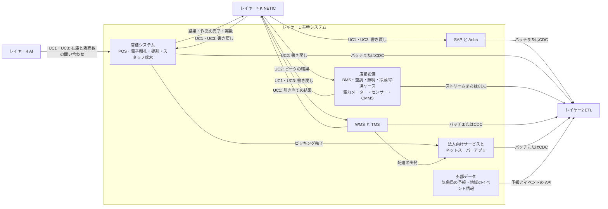

# レイヤー1　基幹システム

小売グループの卸売事業と小売事業が、日々の取引と現場の状態を記録しているシステムと設備です。商品、拠点、発注、店頭の販売、棚割、店舗の設備、倉庫、配送、顧客、ネットスーパーの注文はこの層が原本を持っています。上の層は、この原本のコピーを受け取って判断し、決まった内容をこの層へ書き戻します。

店頭の「今、何本あるか」と「今日何本売れたか」は、この層の POS が直接答えます。問い合わせるのは、UC1 と UC3 ではレイヤー4の AI です。ナレッジグラフは、その場の在庫数を代わりに答えません。

前後: [構成図](../system.md) / [ユースケース](../usecase.md) / [レイヤー2 セマンティックETL](layer-2.md)

## 図にあるもの

名前がスラッシュで並んでいるものは、役割が一つの実装候補です。すべてを同時に入れる必要はありません。

| 名前 | ひとことで | この層での役割 |
| --- | --- | --- |
| SAP S/4HANA | 会社の基幹業務システム | 商品、拠点（店と DC）、発注、店舗や倉庫のあいだの在庫移動、会計を持つ |
| Ariba | 購買のためのネットワーク | 仕入先への発注（PO）をやり取りする |
| PO | Purchase Order、発注伝票 | 仕入先に「この商品を何個ほしい」と出す注文 |
| STO | Stock Transfer Order、在庫移動伝票 | 拠点から拠点へ在庫を移す指示。UC1 では DC から店への補充発注、UC3 では店から店への移動（店間移動）に使う |
| 自動補充 | SAP の発注の推奨 | 過去の同じ曜日の販売から、店ごと・商品ごとに明日の推奨数を出す。イベントや天気は見ない |
| 店舗 POS | レジと店頭在庫 | 販売実績と店頭在庫を持つ。店頭在庫と今日の販売数の問い合わせに答え、入荷予定、売価の変更を受け付ける |
| 電子棚札 | 棚の値札ディスプレイ | 売価や案内を棚に表示する。ダイナミック売価は、状況に応じて変わる価格。UC3 では見切りの値引きを表示する |
| 棚割 | どの商品をどの棚・設備に並べるか | 商品と設備（冷蔵ケースなど）の対応を持つ |
| スタッフ端末 | 売場スタッフの作業端末 | ピッキングと作業指示を受け、完了と実際の数を記録する。図では店舗システムの箱に含まれる |
| BMS | Building Management System、設備の監視と制御 | 空調、照明、冷蔵・冷凍ケースの状態を集め、時刻つきの設定や霜取りのスケジュールを受け付けて設備を動かす |
| 空調・照明 | 売場の空調機と照明ゾーン | BMS から設定温度や調光の指示を受ける |
| 冷蔵・冷凍ケース | 商品を温度帯ごとに保つ設備 | 霜取りの時刻、設定温度、出力を BMS から受ける |
| 電力メーター | 店の受電点の計量器 | 15分ごとのデマンド（平均電力）を測る |
| 温度センサー | 売場とケースに付いたセンサー | 売場の温度、ケースの庫内温度を測る |
| CMMS | Computerized Maintenance Management System、保守管理 | 設備台帳（どの設備がどこにあり、何 kW を使い、何ができるか）と保守の記録を持つ |
| WMS | Warehouse Management System、倉庫管理 | 配送センター（DC）のロット在庫と、店への出荷を管理する。UC1 では店の補充発注を明日の出荷に引き当てる |
| TMS | Transportation Management System、輸配送管理 | トラックとネットスーパー配送車の配車とルートを管理する。UC3 では帰り便に立ち寄りを足す |
| 輸送の温度 IoT | 車の温度センサー | 冷蔵車・冷凍車の庫内温度を測る |
| コールドチェーン | 温度を保ったまま運ぶ流れ | 冷やしたまま届けるための記録 |
| 法人向けサービス | 卸売事業の法人向けサービス | ホテル・飲食（HoReCa）の顧客と取引を持つ |
| ネットスーパーアプリ | 小売事業の顧客向けアプリ | ネットスーパー。お客さんの注文を受け、EC の注文の原本を持つ。配達状況をお客さんに見せる |
| HoReCa | Hotel, Restaurant, Cafe | 法人の飲食顧客 |
| EC | ネット通販 | オンラインの注文 |
| 外部データ（気象局の予報） | 気象局が出す予報 | 店のある地域の外気温の予報。自社の原本ではないが、この層から取り込む |
| 外部データ（地域のイベント情報） | 会場や自治体が公開する催しの予定 | 場所、日時、種類、来場見込み。UC1 で明日の発注を増やす理由になる |

同じ商品でも、卸売事業と小売事業では商品コードが違います。店の発注、POS、ネットスーパーの注文は小売側のコード、DC の在庫と出荷、法人顧客との取引は卸側のコードで記録されます。

| 商品 | 小売側のコード | 卸側のコード | GS1商品コード |
| --- | --- | --- | --- |
| 鮭おにぎり（UC1） | R-9020 | W-41020 | 4900000000214 |
| 塩レモンおにぎり（UC1、明日発売） | R-9105 | W-41105 | 4900000000221 |
| スポーツドリンク 500ml（UC1） | R-3310 | W-31008 | 4900000000306 |
| 氷 1kg（UC1） | R-3901 | W-39010 | 4900000000399 |
| B社 オーガニック牛乳 1L（UC3） | R-5581 | W-10022 | 4900000000023 |

拠点、車両、イベント、設備の ID は [ユースケース一覧](../usecase.md#登場する拠点車両イベント) にまとめています。

## インプット

| どこから | 何が入るか | 形 |
| --- | --- | --- |
| 仕入先、店舗、倉庫、配送の現場 | 発注、入荷、販売、棚の価格変更、棚割、ロット、配送 | 各システムの通常の業務操作 |
| 設備とセンサー | 温度、電力（デマンド）、設備の運転状態 | BMS と電力メーターへの計測値 |
| 気象局 | 外気温の予報（UC1、UC2） | 外部の予報 API |
| 会場・自治体 | 地域のイベントの予定（UC1） | 公開されたイベント情報の API |
| お客さん（ネットスーパーアプリ） | ネットスーパーの注文 | ネットスーパーの注文 |
| レイヤー4 AI（UC1・UC3） | 指定した商品の、今の店頭在庫と今日の販売数の問い合わせ | POS の在庫 API |
| レイヤー4 KINETIC | 決まったアクションの書き戻し。中身は下の表 | BAPI（SAP の呼び出し口）、Webhook（HTTP の通知）、BMS の制御コマンド |

KINETIC から書き戻される中身は、ユースケースごとに次のとおりです。

| 書き戻し先 | UC1 | UC2 | UC3 |
| --- | --- | --- | --- |
| 店舗システム（POS、スタッフ端末、電子棚札） | 1号店の明日の入荷予定。明日 6:30 の島陳列と氷の補充の作業 | なし | 送り出す店の取り出し作業、受け入れる店の受け入れと陳列の作業、2号店の入荷予定、3号店の弁当の見切り価格（19:00 と 20:30） |
| SAP | 1号店から東部 DC への補充発注（スポーツドリンクは96本に修正） | なし | 店間移動伝票2件（牛乳は18本に修正） |
| 店舗設備（BMS） | なし | 霜取りスケジュールの変更、冷凍ケースの予冷と出力、空調の設定温度、窓際の照明の調光、14:20 の AHU-2 の戻し | なし |
| WMS | 明日 5:00 の DC の出荷への引き当て | なし | なし |
| TMS | なし | なし | 帰り便 V-14 と V-40 に2号店の立ち寄りを追加 |

発注や店間移動の原本も書き換えるのは、次の CDC で古い内容がグラフへ戻らないようにするためです。

ピッキング完了と配達の出発は、書き戻しではありません。スタッフ端末と TMS が記録した出来事を、この層の中でネットスーパーアプリが受け取って表示します。

## アウトプット

| どこへ | 何が出るか | 形 |
| --- | --- | --- |
| レイヤー2 の ETL | SAP の商品・拠点・PO・STO、SAP の自動補充の推奨数、POS の販売実績とダイナミック売価、棚割、設備台帳、設備の運転状態、温度と電力の計測値、WMS/TMS の DC ロット在庫・出荷・配送ルート・コールドチェーン、CRM の法人顧客と EC 注文、気象局の予報、地域のイベント情報 | バッチ（まとめて送る）、CDC（変わった分だけ送る）、ストリーム（計測値を送り続ける） |
| レイヤー4 KINETIC | 書き戻しの結果（UC1 は「DC に96本しか残らない」）、作業の完了と実際の数（UC3 は「牛乳は18本」）、受け入れの完了、15:30 のピークの結果 | 書き戻しの応答と、各システムからのイベント（CloudEvents） |
| レイヤー4 AI（UC1・UC3） | 1号店（UC1）と3店（UC3）の店頭在庫と今日の販売数 | POS の在庫 API の応答 |
| お客さん | 配達状況 | ネットスーパーアプリの画面 |

バッチ、CDC、ストリームで上へ渡るのは、その時点のコピーです。「今何本か」「今日何本売れたか」を決める応答は、このコピーではなく POS の API です。

## ユースケースごとの動き

### UC1 明日の発注と需要予測

1. 9:00 SAP の自動補充が、1号店の明日の推奨数（過去4週の同じ曜日の販売から）を出す。推奨数は CDC でレイヤー2へ流れる。地域のイベント情報と気象局の予報も、それぞれ取り込まれている。
2. 10:00 すぎ、レイヤー4の AI が1号店の POS に、4品の店頭在庫と今日の販売数を聞く。明日の朝に残る数の見積もりに使う。明日の発注数の判断はレイヤー3以降が行い、この層は判断しない。
3. 10:15 と 10:31 に、KINETIC から書き戻しが届く。
   - SAP: 1号店から東部 DC への補充発注（推奨数のままの品目、塩レモンおにぎり36個、鮭おにぎり108個、スポーツドリンク120本、氷36袋）
   - WMS: 明日 5:00 の DC の出荷に、1号店の分を引き当てる
   - POS: 1号店の明日の入荷予定
   - スタッフ端末: 明日 6:30 に入口へイベント向けの島陳列を作る作業と、冷凍ケース FZ-01 の氷の補充の作業
4. 10:33 WMS がスポーツドリンク（卸側 W-31008）を引き当てようとすると、ほかの店の発注と合わせて DC に96本しか残らない。この結果が KINETIC に届く。修正後、SAP の補充発注、WMS の出荷、POS の入荷予定が96本になる。
5. 11:00 に発注を締める。翌朝 5:00 に DC から出荷し、6:40 に1号店のスタッフ端末で受け入れをスキャンする。POS の店頭在庫が増える。
6. 明日の閉店後、販売実績は CDC でレイヤー2へ流れる。夕方に余りそうな分は、明日の UC3 の対象になる。

### UC2 電力ピークの自動調整

1. 電力メーター EM-014 のデマンド、売場とケースの温度、空調と冷蔵ケースの運転状態は、ストリームと CDC でレイヤー2へ流れ続ける。気象局の予報も取り込まれる。
2. 12:35 以降、KINETIC から BMS へ、時刻つきの設定がまとめて届く。
   - 冷蔵ケースの霜取り: RC-01〜06 は 12:45、RC-07〜12 は 15:15（もとは全台 14:00）
   - 冷凍ケース FZ-01: 13:00〜14:00 は −22℃ に予冷、14:00〜15:00 は出力を半分
   - 空調 AHU-1〜3: 14:00〜15:00 は 26℃（もとは 25℃）
   - 照明 LZ-4: 14:00〜15:00 は 30% 調光
3. BMS が時刻どおりに設備を動かす。
4. 14:20 窓際の売場の温度センサー ZT-2 が 27.2℃ を測る。この値もストリームでレイヤー2へ届き、レイヤー4の見張りで上限超えがわかる。
5. KINETIC から BMS へ「AHU-2 を 25℃ に戻す」が届く。14:35 に ZT-2 は 26.4℃ に下がる。
6. 15:00 に空調、照明、冷凍ケースが通常の設定に戻り、15:15 に残りの霜取りが動く。15:30 に今日のピークの最大デマンド（785kW）が KINETIC に届く。

### UC3 夕方の在庫融通と見切り

1. 16:00 すぎ、レイヤー4の AI が3店の POS に、期限が今日・明日の日配品と惣菜の店頭在庫と今日の販売数を聞く。
2. KINETIC から次の書き戻しが届く。
   - SAP: 店間移動伝票 T-1601（牛乳20本、1号店から2号店）、T-1602（ヨーグルト55個、3号店から2号店）
   - TMS: 帰り便 V-14 に 17:50、V-40 に 18:10 の2号店の立ち寄りを追加
   - スタッフ端末: 1号店と3号店に取り出し作業、2号店に受け入れと陳列の作業
   - POS: 2号店に入荷予定
3. 17:05 1号店のスタッフ端末が「牛乳は18本しか見つからない」と記録し、KINETIC に届く。修正後、SAP の伝票と2号店の入荷予定が18本になる。
4. 17:50 と 18:10、2号店のスタッフ端末で受け入れをスキャンする。POS の店頭在庫が増える。
5. 19:00 と 20:30、3号店の電子棚札と POS に弁当の見切り価格（30%引き、50%引き）が届く。
6. 閉店後、販売実績と売れ残りは CDC でレイヤー2へ流れる。

## 入出力の図

