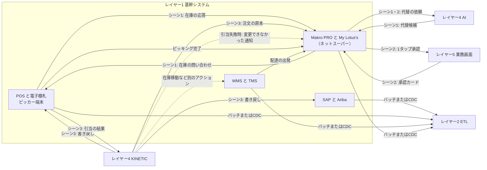

# レイヤー1　基幹システム

CP Axtra の卸（Makro）と小売（Lotus's）が、日々の取引を記録しているシステム群です。商品、発注、店頭の販売、倉庫、配送、顧客、ネットスーパーの注文はこの層が原本を持っています。上の層は、この原本のコピーを受け取って判断し、決まった内容をこの層へ書き戻します。

店頭の「今、何本あるか」は、この層の POS が My Lotus's（ネットスーパー）の問い合わせに直接答えます。ナレッジグラフは、その場の在庫数を代わりに答えません。

前後: [構成図](../system.md) / [レイヤー2 セマンティックETL](layer-2.md)

## 図にあるもの

名前がスラッシュで並んでいるものは、役割が一つの実装候補です。すべてを同時に入れる必要はありません。

| 名前 | ひとことで | この層での役割 |
| --- | --- | --- |
| SAP S/4HANA | 会社の基幹業務システム | 商品、発注、店舗や倉庫のあいだの在庫移動、会計を持つ。シーン3では B社の牛乳の在庫引当と、差額の会計伝票を受け取る |
| Ariba | 購買のためのネットワーク | 仕入先への発注（PO）をやり取りする |
| PO | Purchase Order、発注伝票 | 仕入先に「この商品を何個ほしい」と出す注文 |
| STO | Stock Transfer Order、在庫移動伝票 | 拠点から拠点へ在庫を移す指示 |
| 店舗 POS | レジと店頭在庫 | 販売実績と店頭在庫を持つ。欠品代替では、今の店頭在庫の回答と、代替品の引当を行う |
| 電子棚札 | 棚の値札ディスプレイ | 売価を棚の表示へ反映する。ダイナミック売価は、状況に応じて変わる価格 |
| ピッカー端末 | 売場スタッフの作業端末 | 図では POS の箱に含まれる店舗システムの一部。シーン3で、集める商品を A社の牛乳から B社の牛乳へ書き換え、集め終わると完了を記録する |
| WMS | Warehouse Management System、倉庫管理 | 配送センター（DC）のロット在庫を管理する。在庫移動（STO）などの書き戻し先で、牛乳の例では使わない |
| TMS | Transportation Management System、輸配送管理 | 倉庫から店、店からお客さんの配送を管理する。シーン3では配達の出発を記録する |
| 温度 IoT | 温度センサー | 冷蔵・冷凍の温度を測る |
| コールドチェーン | 温度を保ったまま運ぶ流れ | 牛乳のように冷やしたまま届けるための記録 |
| Makro PRO | Makro の法人向けサービス | ホテル・飲食（HoReCa）の顧客と取引を持つ |
| My Lotus's | Lotus's の顧客向けアプリ | ネットスーパー。お客さんの注文を受け、EC の注文の原本を持つ。承認カードと配達状況をお客さんに見せる |
| HoReCa | Hotel, Restaurant, Cafe | 法人の飲食顧客 |
| EC | ネット通販 | オンラインの注文 |

同じ商品でも、Makro と Lotus's では商品コードが違います。ネットスーパーの注文は Lotus's のコードで記録されます。

| 商品 | Lotus's のコード | Makro のコード |
| --- | --- | --- |
| A社 おいしい牛乳 1L | LS-5502 | MK-10086 |
| B社 オーガニック牛乳 1L | LS-5581 | MK-10022 |

## インプット

| どこから | 何が入るか | 形 |
| --- | --- | --- |
| 仕入先、店舗、倉庫、配送の現場 | 発注、入荷、販売、棚の価格変更、ロット、配送、温度 | 各システムの通常の業務操作 |
| お客さん（My Lotus's） | 「A社 おいしい牛乳 1L（80バーツ）」という注文。商品は LS-5502 | ネットスーパーの注文 |
| My Lotus's から POS（シーン1） | 指定した商品の、今の店頭在庫の問い合わせ。A社が欠品したあとは B社も問い合わせる | POS の在庫 API |
| レイヤー4 AI（シーン1） | 代替候補。「B社 オーガニック牛乳（LS-5581）」 | AI からの応答 |
| レイヤー5 業務画面（シーン2） | 承認カード。「お値段そのまま（80バーツ）で B社オーガニック牛乳に変更してよいか」 | My Lotus's の通知 |
| レイヤー4 KINETIC（シーン3） | 決まった代替の書き戻し。牛乳の例の書き戻し先は POS、SAP、My Lotus's の三つ。WMS は在庫移動など別のアクションの書き戻し先。引当に失敗したときは、My Lotus's への「変更できませんでした」の通知 | BAPI（SAP の呼び出し口）または Webhook（HTTP の通知） |

シーン3で書き戻される中身は、ユースケースでは次の四つです。

- POS: ピッカー端末の対象商品を B社の牛乳にする
- POS と SAP: 在庫から B社の牛乳を1本引き当てる
- SAP: 通常95バーツとの差額15バーツを、店舗負担の会計伝票として残す
- My Lotus's: ネットスーパーの注文の原本を、A社（LS-5502）から B社（LS-5581）へ変える

注文の原本も書き換えるのは、次の CDC で古い注文（A社）がグラフへ戻らないようにするためです。

書き戻しは POS、SAP、My Lotus's の順です。承認のあいだに B社の牛乳が売れて POS で引き当てられなかったときは、KINETIC が残りの書き戻しを止めます。My Lotus's には、注文の原本の変更ではなく「代替できなかった」という通知が届きます（[レイヤー4](layer-4.md#b社の引当に失敗したとき)）。

ピッキング完了と配達出発は、書き戻しではありません。ピッカー端末と TMS が記録した出来事を、この層の中で My Lotus's が受け取って表示します。

## アウトプット

| どこへ | 何が出るか | 形 |
| --- | --- | --- |
| レイヤー2 の ETL | SAP の商品・PO・STO、POS の販売実績とダイナミック売価、WMS/TMS の DC ロット在庫とコールドチェーン、CRM の法人顧客と EC 注文 | バッチ（まとめて送る）または CDC（変わった分だけ送る） |
| My Lotus's（シーン1） | 店頭在庫。例は「最後の1本が売れて在庫ゼロ」、つづいて「B社は在庫あり」 | POS の在庫 API の応答 |
| レイヤー4 AI（シーン1・2） | 代替の依頼。「A社（LS-5502）が欠品。代替はどれか」、在庫確認のあとは「B社は在庫あり。提案を作って」 | My Lotus's からの依頼 |
| レイヤー5 業務画面（シーン2） | お客さんの1タップ承認（14:22） | My Lotus's からの応答 |
| レイヤー4 KINETIC（シーン3） | POS の引当の結果。成功、または在庫なしで失敗 | 書き戻しの応答 |
| お客さん（シーン2・3） | 承認カード。承認後は「ピッキングが完了し、配達に出発した」 | My Lotus's の画面 |

バッチと CDC で上へ渡るのは、その時点のコピーです。注文の瞬間に「今何本か」を決める応答は、このコピーではなく POS の API です。

## 牛乳が欠品したとき

1. お客さんが My Lotus's で A社の牛乳（LS-5502）を注文する。
2. My Lotus's が POS に店頭在庫を聞く。POS は在庫ゼロと返す。
3. My Lotus's がレイヤー4の AI に代替を頼む。代替の判断はレイヤー3以降が行い、この層は判断しない。
4. My Lotus's が、候補になった B社の牛乳（LS-5581）の在庫を POS に再度聞く。POS は在庫ありと返す。
5. My Lotus's が、業務画面から届いた承認カードをお客さんに見せ、1タップの承認を業務画面へ返す。
6. KINETIC からの書き戻しで、ピッカー端末、在庫の引当、会計伝票、注文の原本が更新される。POS で引き当てられなかったときは、ここで止まり、My Lotus's に「変更できませんでした」が届く。
7. スタッフがピッキングを終え、TMS が配達の出発を記録すると、My Lotus's に表示される。

## 入出力の図

