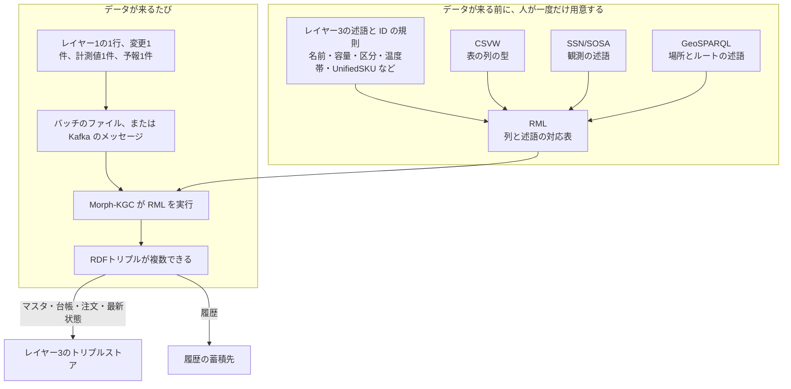

# レイヤー2　セマンティックETL

基幹システムのコピーを、ナレッジグラフが読める「三つ組」に変換する層です。ETL は Extract（取り出す）、Transform（形を変える）、Load（載せる）の略です。図の名前にある HyperAuto は、この変換を自動で行う製品の呼び名で、ここではその役をこの層が担います。

店頭の「今、何本あるか」と「今日何本売れたか」は、レイヤー1の POS が直接答えます。この層を通るのは、商品の名前や温度帯、棚割、店・設備・車両の台帳、注文、販売実績、センサーと電力メーターの計測値、配送のルート、気象局の予報、顧客のように、コピーして使うデータです。

行き先は二つです。商品マスタ、店・設備・車両の台帳、棚割、顧客、注文と、ロット、設備、センサー、電力メーター、予報、売価、車両のルートの「最新の状態」は、レイヤー3のトリプルストアへ入れます。販売明細、温度と電力の連続記録、在庫移動や発注の履歴、注文の変更履歴は、履歴の蓄積先（データレイク）へ入れます。

前後: [レイヤー1 基幹システム](layer-1.md) / [レイヤー3 ナレッジグラフ](layer-3.md)

## RDFトリプルになるまで

三つ組（RDFトリプル）は、事実を一つだけ書いた文です。部品はいつも三つです。

| 部品 | 役割 | 牛乳の例 |
| --- | --- | --- |
| 主語 | どのものか | B社の牛乳（商品 W-10022） |
| 述語 | どの項目か | 容量 |
| 目的語 | その値 | 1L |

1行の表は、項目の数だけ三つ組になります。変換の道具は次の順で動きます。RML がレシピ、CSVW と SSN/SOSA と GeoSPARQL はレシピが参照する辞書、Kafka は差分と計測値の輸送、Morph-KGC はレシピを実行する係です。



### 1. 述語と ID の規則をレイヤー3で決めておく

「容量」「区分」「温度帯」「アレルギー成分」「通常価格」「GS1商品コード」「並ぶ設備」「置かれた店」「消費電力」という項目の ID は、レイヤー3のオントロジーが持ちます。レイヤー2は項目を新しく発明せず、その ID へ値を入れます。

卸売事業と小売事業で別コードの同じ商品をまとめる UnifiedSKU も、レイヤー3が「GS1商品コード（GTIN）が同じ商品は、同じ UnifiedSKU」という規則として決めておきます。ID は `U-` に GTIN をつないだものです。レイヤー2の RML は、この規則どおりに ID を作るだけです。

### 2. 列と述語の対応を RML に書く

RML（RDF Mapping Language）は変換のレシピです。毎回のデータではなく、人が先に書きます。内容は次の三つの指定です。

- 1行を、どの主語にするか
- どの列を、どの述語にするか
- 値が文字列か、数値か、別のものの ID か

表が CSV やデータベースの抽出であるときは、CSVW が列の意味を添えます。たとえば「3列目は商品コードという文字列、5列目は円の数値」です。Morph-KGC はこの定義を見て、列の位置から値を取ります。

温度や電力のようにセンサーや計量器の観測であるときは、述語に SSN/SOSA の語彙を使います。店の位置や配送車のルートのように場所を持つデータは、GeoSPARQL の語彙で点や線を書きます。SSN/SOSA も GeoSPARQL も変換ソフトではなく、決まった述語の集まりです。RML は表だけでなく JSON も読めるので、予報 API の JSON もそのまま入力にできます。

### 3. レイヤー1からデータを取り出す

取り出し方は三つです。中身の形が違うだけで、あとの RML は同じものを使います。

| 取り出し | いつ使うか | レイヤー2に届く形 |
| --- | --- | --- |
| バッチ | 商品マスタ、設備台帳、棚割、一日分の販売のように、まとめて移すとき | 表のファイル、またはデータベースの抽出結果 |
| CDC | 価格、注文、店間移動、配送のルート、設備の運転状態が変わった分だけを、その都度移すとき | 変更1件が Kafka のメッセージ。Kafka は届いた順にメッセージを保持するパイプ |
| ストリーム | 温度センサーや電力メーターの計測値を送り続けるとき | 計測1件が Kafka のメッセージ |

気象局の予報は、予報 API を定期的に読みに行き、新しい予報があれば1件のメッセージとして Kafka に載せます。

Kafka に載ったメッセージは、一定量ごと、または1件ごとに、RML が読める表や JSON に整えます。Morph-KGC がそのデータと RML を受け取ります。

### 4. Morph-KGC が1行から三つ組を複数つくる

Morph-KGC は RML を実行するツールです。行を読み、レシピどおりに三つ組を出力します。使う列が5個なら、三つ組はおおよそ5個できます。列の値から別の ID（UnifiedSKU など）を作る規則があれば、その分も増えます。主語は同じものの1行のまま、述語だけが列ごとに変わります。

### 5. 三つ組を行き先へ入れる

出力は RDF のファイル（中身は三つ組の羅列）です。データの種類で行き先を分けます。

| 種類 | 行き先 | 入れ方 |
| --- | --- | --- |
| 商品マスタ、店・設備・車両の台帳、棚割、顧客、注文、店間移動 | レイヤー3のトリプルストア | 主語の ID が既にあれば、同じ述語の値を更新する |
| ロット、設備の運転状態、センサーと電力メーターの最新の観測、予報、ダイナミック売価の今の値、車両の今夜のルート | レイヤー3のトリプルストア | 主語ごとに最新の1件だけを残し、新しい値が来たら差し替える |
| 販売明細、温度と電力の連続記録、在庫移動や発注の履歴、注文の変更履歴 | 履歴の蓄積先 | 追記するだけ。トリプルストアには入れない |

注文は両方へ入ります。トリプルストアには今の注文だけを置き、変わるたびに差し替えます。履歴の蓄積先には、変更1件ごと（代替した、代替を取り消した、など）を追記します。コントロールタワーは、この変更履歴から欠品と代替の件数を数えます。店間移動も同じで、確定した移動はトリプルストアに、受け入れまで終わった移動の記録は履歴の蓄積先に入ります。

CDC で「通常価格だけ変わった」場合は、トリプルストアの価格の三つ組だけが新しい値になります。

## 商品1行が三つ組になる例

次の表は、SAP の商品マスタ（卸側）からバッチで出た1行の例です。列名は説明用です。

| MATNR | NAME | VOL | KIND | TEMP | ALLERGEN | PRICE | GTIN |
| --- | --- | --- | --- | --- | --- | --- | --- |
| W-10022 | B社 オーガニック牛乳 | 1L | 無調整 | 冷蔵 | 乳 | 285 | 4900000000023 |

RML には、先に次の対応が書いてあります。

| ルール | 内容 |
| --- | --- |
| 主語 | 列 MATNR の値を、商品の ID にする |
| 名前 | 列 NAME を、述語「名前」にする |
| 容量 | 列 VOL を、述語「容量」にする |
| 区分 | 列 KIND を、述語「区分」にする |
| 温度帯 | 列 TEMP を、述語「温度帯」にする。値はレイヤー3の温度帯（冷凍、冷蔵、常温）の ID |
| アレルギー | 列 ALLERGEN を、述語「アレルギー成分」にする |
| 価格 | 列 PRICE を、述語「通常価格」にする。単位は円 |
| GS1 | 列 GTIN を、述語「GS1商品コード」にする |
| 同じ商品 | 列 GTIN から `U-` + GTIN の UnifiedSKU の ID を作り、述語「同じ商品」でつなぐ。規則はレイヤー3が決めたもの |

Morph-KGC がこの行を実行すると、三つ組が8個できます。読み下しは次のとおりです。

| 主語 | 述語 | 目的語 |
| --- | --- | --- |
| 商品 W-10022 | 名前 | B社 オーガニック牛乳 |
| 商品 W-10022 | 容量 | 1L |
| 商品 W-10022 | 区分 | 無調整 |
| 商品 W-10022 | 温度帯 | 冷蔵 |
| 商品 W-10022 | アレルギー成分 | 乳 |
| 商品 W-10022 | 通常価格 | 285 |
| 商品 W-10022 | GS1商品コード | 4900000000023 |
| 商品 W-10022 | 同じ商品 | UnifiedSKU U-4900000000023 |

最後の1行は、小売側の別コードがあっても同じ商品だと結ぶための三つ組です。

ストアに入るときの形は、主語も述語も ID（URI）です。1個だけ書くと次のようになります。

```turtle
<urn:example:sku:W-10022> <urn:example:ns:name> "B社 オーガニック牛乳" .
```

ピリオドまでが三つ組の1個です。容量や価格も、同じ主語で同じ形の行が続きます。

小売側の商品マスタに `R-5581` という別コードで同じ牛乳がある場合も、別の行として同じ手順を通ります。GTIN が同じなので、RML は両方のコードを同じ `U-4900000000023` へ結びます。レイヤー3では一つの商品として探せます。

## 温度1件が三つ組になる例

UC2 で、1号店の窓際の売場の温度センサーが「27.2℃」を測ると、ストリームで Kafka にメッセージが1件載ります。

| sensor | time | celsius |
| --- | --- | --- |
| ZT-2 | 14:20 | 27.2 |

メッセージに「観測 ID」の列はありません。主語は RML が `sensor` と `time` をつないで作ります。この例では `ZT-2` と `14:20` から `観測 ZT-2/14:20` です。述語には SSN/SOSA を使います。

| 主語 | 述語 | 目的語 | 値の出どころ |
| --- | --- | --- | --- |
| 観測 ZT-2/14:20 | 観測したセンサー | センサー ZT-2 | 列 sensor |
| 観測 ZT-2/14:20 | 観測した項目 | 温度 | RML に書いた固定値。このメッセージは温度計のもの、という指定 |
| 観測 ZT-2/14:20 | 結果 | 27.2 | 列 celsius |
| 観測 ZT-2/14:20 | 時刻 | 14:20 | 列 time |

この4個の三つ組は、履歴の蓄積先へ全件を追記します。トリプルストアには、センサー `ZT-2` の最新の観測1件だけを置き、次の観測が来たら差し替えます。センサーがどこに付いているか（ZT-2 は窓際の惣菜コーナーで、空調 AHU-2 が受け持つ）は、CMMS の設備台帳からバッチで入ります。

電力メーター EM-014 の15分ごとのデマンドも、同じ形です。「観測した項目」が温度ではなく電力になり、結果の単位が kW になるだけです。

## 予報1件が三つ組になる例

UC2 で、気象局の予報 API から次の JSON が届きます（説明用に短くしています）。

| area | time | max_celsius |
| --- | --- | --- |
| 東部地域 | 今日 14:00 | 37 |

| 主語 | 述語 | 目的語 |
| --- | --- | --- |
| 予報東部地域/今日14:00 | 予報した項目 | 外気温 |
| 予報東部地域/今日14:00 | 結果 | 37 |
| 予報東部地域/今日14:00 | 対象の地域 | 地域東部地域（GeoSPARQL の範囲） |

店の位置（点）は、店の台帳からバッチで GeoSPARQL で入っています。そのため、レイヤー3では「この店にかかる予報」を問い合わせで探せます。同じように、TMS の今夜の配送ルートは GeoSPARQL の線として入り、UC3 で「ルートの近くにある店」を探せます。

商品マスタも、温度も、予報も、手順は同じです。違うのは、バッチの表か Kafka の1件か、RML が選ぶ述語が商品用か SSN/SOSA か GeoSPARQL か、行き先がどこか、だけです。

## 図にあるもの

| 名前 | ひとことで | 手順のどこで使うか |
| --- | --- | --- |
| セマンティックETL | 意味をそろえて移す処理 | 手順全体の名前 |
| RML | 列と述語の対応を書く標準 | 手順2。データを変換するレシピ |
| CSVW | 表の列の型を書く標準 | 手順2。CSV や抽出表の列を RML が読むとき |
| SSN | センサーと観測の語彙 | 手順2。温度と電力の三つ組で使う述語 |
| SOSA | 観測一つを表す語彙 | 手順2。SSN と組み合わせて、結果と時刻を書く |
| GeoSPARQL | 場所とルートの語彙 | 手順2。店の位置、予報の地域、配送ルートを書く |
| バッチ | 決まった時刻にまとめて送る | 手順3。商品マスタ、設備台帳、棚割、一日分の販売 |
| CDC | 変わった行だけを送る | 手順3。価格、注文、店間移動、ルート、設備の運転状態の更新 |
| ストリーム | 計測値を送り続ける | 手順3。温度センサーと電力メーターの計測値 |
| Kafka | 変更を順番に保持するパイプ | 手順3。CDC、ストリーム、予報のメッセージを ETL まで運ぶ |
| Morph-KGC | RML を実行するツール | 手順4。1行から三つ組を複数つくる |
| RDFトリプル | 主語・述語・目的語の一つ | 手順4の出力。手順5で行き先へ入る |
| 履歴の蓄積先 | 履歴をためる安価な置き場 | 手順5。販売明細、温度と電力の連続記録、在庫移動の履歴、注文の変更履歴 |

## インプット

すべてレイヤー1から、バッチ、CDC、ストリームのどれかで届きます。

| どこから | 何が入るか | レシピが参照するもの | 行き先 |
| --- | --- | --- | --- |
| SAP S/4HANA と Ariba | 商品（温度帯を含む）、拠点、発注 PO、在庫移動 STO | RML。表なら CSVW | 商品、拠点、確定した店間移動はトリプルストア。PO と STO の履歴は履歴の蓄積先 |
| 店舗システム（POS、電子棚札、棚割） | 販売実績、ダイナミック売価、棚割 | RML。表なら CSVW | 今の売価と棚割はトリプルストア。販売実績は履歴の蓄積先 |
| 店舗設備（BMS、電力メーター、センサー、CMMS） | 設備台帳（場所、消費電力、動かせる幅）、運転状態（霜取りの予定、設定温度）、温度と電力の計測値 | RML。述語は SSN / SOSA | 台帳、運転状態、センサーごとの最新の観測はトリプルストア。計測値の連続記録は履歴の蓄積先 |
| WMS / TMS | 配送センターのロット在庫、車両の台帳（冷蔵か、保冷時間、空き）、今夜の配送ルート | RML。ルートは GeoSPARQL | ロットの最新の状態、車両、今夜のルートはトリプルストア。動きの記録は履歴の蓄積先 |
| 法人向けサービス / ネットスーパーアプリ | HoReCa の法人顧客、EC の注文（対象商品、支払額、承諾済み上限額、出荷店、配達枠） | RML。表なら CSVW | 顧客と今の注文はトリプルストア。注文の変更履歴は履歴の蓄積先 |
| 外部データ（気象局の予報） | 地域、時刻、外気温の予報 | RML。地域は GeoSPARQL | 最新の予報だけトリプルストア |

## アウトプット

| どこへ | 何が出るか | 形 |
| --- | --- | --- |
| レイヤー3 の RDF トリプルストア | 商品マスタ、店・設備・車両の台帳、棚割、顧客、注文、店間移動と、ロット・設備・センサー・電力メーター・予報・売価・ルートの最新の状態 | RDF トリプル |
| 履歴の蓄積先 | 販売明細、温度と電力の連続記録、在庫移動や発注の履歴、注文の変更履歴。レイヤー5のコントロールタワーが集計に使う | RDF トリプルを追記 |

## ユースケースごとの動き

### UC1 ネットスーパーの欠品代替

A社の牛乳と B社の牛乳について、名前、容量、区分、温度帯、通常価格、アレルギー成分、GS1商品コード、UnifiedSKU は、上の手順で既にグラフへ入っています。注文 8841（対象 R-5502、支払額240円、承諾済み上限額240円、出荷店1号店、配達枠 15:00〜16:00）も CDC で入っています。OWL は、その三つ組を見て「A社と同じ容量・同じ区分」を探します。

お客さんが注文した瞬間の「在庫ゼロ」は、この手順の入力ではありません。ネットスーパーアプリが POS に聞いた結果です。

KINETIC が注文の原本を B社（R-5581）へ書き戻すと、次に CDC で届く注文も B社になり、レイヤー3で更新済みの内容と一致します。注文の変更履歴には「代替した」が1件追記されます。

### UC2 電力ピークの自動調整

1号店の設備台帳（空調、照明、冷蔵ケース、冷凍ケースの場所、消費電力、動かせる幅）と、霜取りの予定（全台 08:00、14:00、20:00）は、既に入っています。電力メーター、売場とケースの温度センサーの計測値は、ストリームで1件ずつ届き、トリプルストアの最新の観測を差し替えながら、履歴の蓄積先に連続記録として残ります。12:30 の時点で、今日の外気温の予報（37℃）も入っています。

KINETIC が BMS に霜取りの時刻と設定温度を書き戻すと、BMS の運転状態が CDC で届き、レイヤー3で確定した調整計画と一致します。14:20 の ZT-2 の 27.2℃ も、この流れで最新の観測になり、レイヤー4の見張りが SHACL で気づきます。電力と温度の連続記録は、あとでコントロールタワーの BI が「今日はどれだけピークを削れたか」を見るのに使います。

### UC3 夕方の在庫融通と見切り

3店の位置、商品の温度帯と「日配品」「惣菜」の区分、ネットスーパー配送車 V-14 と V-40 の台帳（冷蔵、保冷2時間、空き）と今夜のルートは、既に入っています。店頭在庫、その期限ごとの内訳、今日の販売数は入っていません。AI が POS に聞きます。

KINETIC が SAP に店間移動を書き戻すと、CDC で同じ内容が届き、レイヤー3で確定した移動 T-1601（18本に修正後）と T-1602 に一致します。TMS のルートに立ち寄りが足されると、今夜のルートも差し替わります。受け入れが終わった移動は、在庫移動の履歴として履歴の蓄積先に入ります。
