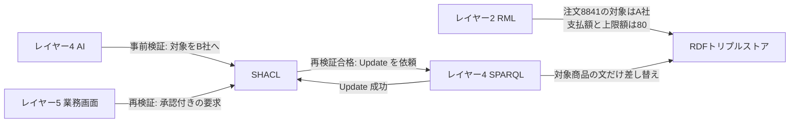
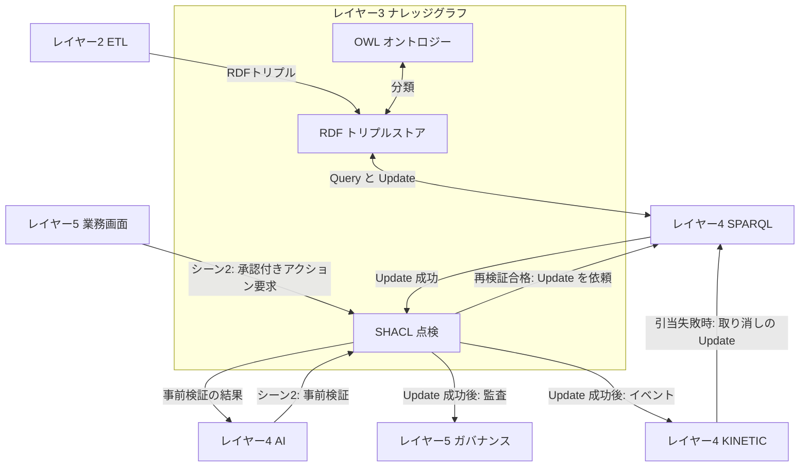

# レイヤー3　ナレッジグラフ

「何が何と同じで、何をしてよいか」を機械が扱える形で持つ層です。図の Foundry Ontology は、この役の製品名です。ここではオントロジー（言葉の定義）、トリプルストア（データの保管）、SHACL（書き込む前の点検）の三つに分かれています。

ベテラン店員が「A社と同じ1Lの無調整牛乳」を思いつく部分が、この層の OWL です。乳成分が元の商品と一致するか、支払額がお客さんの承諾済みの80バーツを超えないか、店舗負担の差額が値引上限以内かは、この層の SHACL が点検します。

前後: [レイヤー2 セマンティックETL](layer-2.md) / [レイヤー4 AI推論とキネティック実行](layer-4.md)

## 図にあるもの

GraphDB、Stardog、Neptune はトリプルストアの実装候補で、どれか一つです。

| 名前 | ひとことで | この層での役割 |
| --- | --- | --- |
| オントロジー | 種類と関係の辞書 | 商品、店、ロットが何であり、どう結ばれるかを定義する |
| OWL 2 | その辞書の標準言語 | 元の商品と「同じ容量」「同じ区分」の商品を、代替候補に分類する |
| SKOS | 用語のゆるい階層 | 上位語・下位語のような呼び分けを表す |
| GS1 | 商品や場所の国際的な識別 | 商品のバーコード（GTIN）や、店の国際的な番号のように、社外と共有できる ID |
| UnifiedSKU | Makro と Lotus's で共通の商品 | 別コードの同じ商品を一つにまとめる。ID は GS1商品コードから作る |
| Store | 店 | どの店の話かを表す |
| Batch | ロット | いつの製造・入荷のまとまりかを表す |
| RDF トリプルストア | 三つ組のデータベース | 人が書いた定義、レイヤー2が読み取った文、点検に合格した更新を保管する。同じ牛乳かどうかは問い合わせのときに計算する |
| RDF 1.2 | 三つ組の標準 | 主語・述語・目的語で事実を書く |
| RDF-star | 事実についての事実 | 「この関係は、この根拠で言える」を三つ組の上に書ける。この例では使わない |
| URI | 一つひとつに付く固定の ID | 商品や店や注文を、システムをまたいで指す |
| SHACL | 形と禁止事項のチェックリスト | 通過したものだけを更新してよい |
| 乳成分の一致 | シーン2の点検 | 代替品のアレルギー成分（乳）が元の商品と同じか |
| 支払額上限 | シーン2の点検 | 提案後の支払額が、お客さんが注文時に承諾した額を超えていないか |
| 値引上限 | シーン2の点検 | 店舗が負担する差額が、許容の天井（例は代替品の通常価格の20%）を超えていないか |
| 在庫移動ルール | 在庫を動かしてよい条件 | 在庫移動（STO）の前に確認する規則。牛乳の例では使わない |
| 承認 | シーン2の再検証で見る点検 | お客さん自身の承認が付いた要求か |

## RDFトリプルストアの中身

ストアの中身は、商品テーブルではありません。主語・述語・目的語の文が、一つの置き場に並んでいます。ID は説明用です。保存する文は、次の4種類です。

| 種類 | 誰が置くか | いつ増えるか |
| --- | --- | --- |
| オントロジーの定義 | 人 | 言葉の定義を変えたとき |
| SHACL の定義 | 人 | 点検規則を変えたとき |
| レイヤー2が読み取った文 | レイヤー2の RML | 商品マスタ、顧客、注文の行が来たとき。ロット、温度、売価は最新の1件を差し替える |
| 合格した更新 | レイヤー4の SPARQL Update | SHACL の再検証に合格したとき（シーン2の注文の差し替え）。KINETIC が引当に失敗して元に戻すときも、この Update で差し替える |

販売明細、温度の連続記録、在庫移動や発注の履歴、今の店頭在庫の本数は入れません。履歴はレイヤー2が履歴の蓄積先へ送り、店頭在庫は POS が答えます。承認の「14:22にお客さん自身が承認した」はレイヤー5の監査グラフに PROV-O で残し、このストアの文にはしません。RDF-star（文についての文）も、このユースケースでは使いません。

### オントロジーの定義

人が一度書く文です。商品の行からは作りません。図の OWL 2、SKOS、GS1、UnifiedSKU、Store、Batch は、ここに入ります。

| 主語 | 述語 | 目的語 | 図のどれか |
| --- | --- | --- | --- |
| UnifiedSKU | 種類 | 商品の共通ID | UnifiedSKU |
| UnifiedSKU | ID の作り方 | GS1商品コードが同じ商品は、同じ UnifiedSKU | UnifiedSKU、GS1 |
| Store | 種類 | 店 | Store |
| Batch | 種類 | ロット | Batch |
| 牛乳 | 上位語 | 乳製品 | SKOS |
| 無調整 | 属する区分体系 | 牛乳の区分 | SKOS |
| 代替の候補 | 一致させる項目 | 容量 | OWL 2 |
| 代替の候補 | 一致させる項目 | 区分 | OWL 2 |
| 代替の候補 | 区分の属する体系 | 牛乳の区分 | OWL 2、SKOS |
| 欠品代替の方針 | 代替後の支払額 | 元の注文の支払額のまま | OWL 2 |
| 欠品代替の方針 | 差額の負担 | 店舗 | OWL 2 |
| 商品コード | 書き方 | GS1 の商品識別 | GS1 |
| 店コード | 書き方 | GS1 の拠点識別 | GS1 |

商品の文には「牛乳である」という分類の文はありません。区分の「無調整」が SKOS で「牛乳の区分」に属しているので、区分を見れば牛乳だとわかります。

欠品代替の方針は、レイヤー4の AI が提案を作るときに読む決まりです。「80バーツのまま、差額は店舗負担」という提案はこの方針から生まれます。方針どおりでも店舗の負担が大きすぎないかは、SHACL の値引上限が止めます。

店とロットは、種類の定義として入ります。ロットの最新の状態（どの DC にあるか）と、センサーごとの最新の温度の観測は、レイヤー2が読み取った文として入ります。動きの履歴は入りません。

### SHACL の定義

点検の規則も、人が書いて置く文です。オントロジーとは別です。図にある点検は、すべてここです。注文が承認されるより前から入っていて、合格・不合格のたびに増えません。

| 主語 | 述語 | 目的語 | 図のどれか |
| --- | --- | --- | --- |
| 乳成分の点検 | 比べるもの | 代替品のアレルギー成分 | 乳成分の一致 |
| 乳成分の点検 | 一致させる相手 | 元の商品のアレルギー成分 | 乳成分の一致 |
| 支払額の点検 | 対象 | 提案後の注文の支払額 | 支払額上限 |
| 支払額の点検 | 超えてはいけない値 | 注文の承諾済み上限額 | 支払額上限 |
| 値引上限の点検 | 対象 | 店舗負担の差額（代替品の通常価格 − 支払額） | 値引上限 |
| 値引上限の点検 | 超えてはいけない値 | 代替品の通常価格の20% | 値引上限 |
| 在庫移動の点検 | 対象 | 在庫を動かす提案 | 在庫移動ルール |
| 在庫移動の点検 | 満たす条件 | 移動してよい条件。ロットの最新の状態を見る | 在庫移動ルール |
| 承認の点検 | 対象 | 承認時のアクション要求 | 承認 |
| 承認の点検 | 必要なもの | お客さん自身の承認（誰が、いつ） | 承認 |

SHACL という名前は、この規則と、規則を実行する点検係の両方を指します。点検係はストアの中の規則を読みます。

シーン2では、点検が2回走ります。

| いつ | 誰が頼むか | 使う点検 | 合格したら |
| --- | --- | --- | --- |
| 事前検証（通知の前） | レイヤー4の AI | 乳成分、支払額、値引上限 | 結果を AI に返すだけ。ストア、監査、KINETIC には何も出さない |
| 再検証（1タップのあと） | レイヤー5の業務画面 | 事前検証と同じ点検 ＋ 承認 | SPARQL Update の依頼。Update の成功が返ってきたら、監査イベントと KINETIC へのイベント |

再検証するのは、通知から承認までのあいだに、通常価格や注文が変わっているかもしれないからです。

### レイヤー2が読み取った文

基幹システムから RML が読み取った行です。商品マスタも注文も、ここに入るまでの手順は同じです。違うのは、読み取る列と、主語になる列です。

#### 商品マスタ

主語は商品コードです。使う列は、名前、容量、区分、アレルギー成分、通常価格、GS1商品コードです。UnifiedSKU への対応は、GS1商品コードから作ります。

ネットスーパーの注文は Lotus's のコードを使うので、ここでは Lotus's 側の2商品を示します。

| 主語 | 述語 | 目的語 |
| --- | --- | --- |
| 商品 LS-5502 | 名前 | A社 おいしい牛乳 |
| 商品 LS-5502 | 容量 | 1L |
| 商品 LS-5502 | 区分 | 無調整 |
| 商品 LS-5502 | アレルギー成分 | 乳 |
| 商品 LS-5502 | 通常価格 | 80 |
| 商品 LS-5502 | GS1商品コード | 8851000000086 |
| 商品 LS-5502 | 同じ商品 | UnifiedSKU U-8851000000086 |
| 商品 LS-5581 | 名前 | B社 オーガニック牛乳 |
| 商品 LS-5581 | 容量 | 1L |
| 商品 LS-5581 | 区分 | 無調整 |
| 商品 LS-5581 | アレルギー成分 | 乳 |
| 商品 LS-5581 | 通常価格 | 95 |
| 商品 LS-5581 | GS1商品コード | 8851000000024 |
| 商品 LS-5581 | 同じ商品 | UnifiedSKU U-8851000000024 |

Makro 側の `MK-10086`（A社）と `MK-10022`（B社）も、同じ形の文を持ちます。GS1商品コードが同じなので、`MK-10086` と `LS-5502` は `U-8851000000086` を、`MK-10022` と `LS-5581` は `U-8851000000024` を指します。グラフでは、それぞれ一つの商品として探せます。

#### 注文

主語は注文番号です。使う列は、対象商品、支払額、承諾済み上限額です。レジ明細の全行は読み取りません。

お客さんが A社の牛乳を 80 バーツで頼んだ時点で、次の文が入ります。

| 主語 | 述語 | 目的語 |
| --- | --- | --- |
| 注文 8841 | 対象商品 | 商品 LS-5502 |
| 注文 8841 | 支払額 | 80 |
| 注文 8841 | 承諾済み上限額 | 80 |

承諾済み上限額は、お客さんが注文の時点で払うと決めた額です。B社の通常価格 95 は商品 `LS-5581` の文のままです。注文 `8841` の支払額 80 は、この注文でお客さんが払う金額です。

シーン2の提案は、新しい注文を作ることではありません。すでに入っている対象商品を、A社から B社へ変えてよいかです。

| 項目 | 値 |
| --- | --- |
| 注文 | 8841 |
| いまの対象 | 商品 LS-5502（A社 おいしい牛乳） |
| 変えたい対象 | 商品 LS-5581（B社 オーガニック牛乳） |
| 支払額 | 80バーツのまま |
| 店舗負担の差額 | 15バーツ（95 − 80） |

SHACL は、この提案をストアの文に照らします。

| 点検 | 見ている文 | 結果 |
| --- | --- | --- |
| 乳成分は同じか | LS-5502 のアレルギー成分は乳、LS-5581 も乳 | 合格 |
| 支払額は承諾済み上限額を超えないか | 提案後の支払額は 80、注文 8841 の承諾済み上限額は 80 | 合格 |
| 差額は値引上限以内か | 差額は 15、上限は LS-5581 の通常価格 95 の20%で 19 | 合格 |
| 承認はあるか（再検証だけ） | 14:22 のお客さん自身の1タップ | 合格 |

再検証に合格すると、レイヤー4の SPARQL が Update で対象商品の文だけを差し替え、成功を SHACL に返します。支払額と承諾済み上限額の文はそのままです。

| 主語 | 述語 | 目的語 |
| --- | --- | --- |
| 注文 8841 | 対象商品 | 商品 LS-5581 |
| 注文 8841 | 支払額 | 80 |
| 注文 8841 | 承諾済み上限額 | 80 |

不合格なら、対象商品は `LS-5502` のままです。

シーン3で KINETIC が B社の牛乳を引き当てられなかったときは、KINETIC が SPARQL Update で対象商品を `LS-5502` に戻します。これは新しい提案ではなく、合格した変更の取り消しなので、SHACL は通しません。

「14:22にお客さん自身が承認した」は、このストアの文ではなく、レイヤー5の監査グラフに来歴（PROV-O）として残します。

シーン3で My Lotus's の注文の原本も `LS-5581` へ書き戻されます。そのため、次に CDC で届く注文の文と、ここで差し替えた文は一致します。

### 同じ牛乳かどうかは、保存しない

`LS-5502` も `LS-5581` も、レイヤー2が読み取った文としてすでに「容量は 1L」「区分は無調整」を持っています。オントロジーには「代替の候補は、元の商品と同じ容量・同じ区分の牛乳」と書いてあります。OWL は問い合わせのとき、A社と同じ値を持つ商品を候補として返します。Makro 側のコードは同じ UnifiedSKU なので、候補は UnifiedSKU ごとに一つにまとまります。ネットスーパーの注文は Lotus's 側のコードを使うので、問い合わせは候補を注文と同じ Lotus's 側のコード（`LS-5581`）で返します。

「分類は代替の候補」という文は、ストアに足しません。容量や区分が変わったあと、古い分類が残るのを避けるためです。

## インプット

| どこから | 何が入るか | どの箱が受け取るか |
| --- | --- | --- |
| オントロジーの作成者 | UnifiedSKU、Store、Batch、代替の候補を判断する定義、欠品代替の方針 | OWL |
| ルールの作成者 | 乳成分の一致、支払額上限、値引上限、在庫移動、承認 | SHACL |
| レイヤー2 ETL | レイヤー2が読み取った文。商品マスタは名前、容量、区分、アレルギー成分、通常価格、GS1商品コード、UnifiedSKU への対応。顧客。注文は対象商品、支払額、承諾済み上限額。ロット、センサーごとの温度、売価は最新の状態 | RDF |
| レイヤー4 SPARQL | 代替を探す問い合わせ（Query）と、欠品代替の方針の読み取り | RDF。OWL の定義と合わせて答える |
| レイヤー4 AI | シーン2の事前検証の依頼。例は「LS-5581 を80バーツのまま提供してよいか」 | SHACL |
| レイヤー5 業務画面 | シーン2の承認付きアクション要求 | SHACL |
| レイヤー4 SPARQL Update | 再検証に合格した提案による、注文の対象商品の差し替え。引当に失敗したときの取り消し（KINETIC から） | RDF |
| レイヤー4 SPARQL | Update の成功の応答 | SHACL。監査と KINETIC へのイベントを出す合図 |

## アウトプット

| どこへ | 何が出るか | 条件 |
| --- | --- | --- |
| レイヤー4 SPARQL | 代替候補。牛乳の例では「B社 オーガニック牛乳（LS-5581、通常95バーツ）」 | シーン1の問い合わせに対する OWL の分類結果 |
| レイヤー4 SPARQL | グラフの検索結果全般。画面や AI が読む | Query の応答 |
| レイヤー4 AI | 事前検証の結果 | 事前検証のとき。合格しても何も書き込まない |
| レイヤー4 SPARQL | 注文の対象商品を差し替える Update の依頼 | 再検証に合格したとき |
| レイヤー4 KINETIC | 変更が確定したというイベント | 再検証に合格し、Update の成功が返ってきたとき。シーン3の起点 |
| レイヤー5 ガバナンス | 監査イベント。誰が、いつ、何を承認したか | 再検証に合格し、Update の成功が返ってきたとき |

再検証が不合格のときは、注文の更新、監査記録、KINETIC へのイベントは出ません。アクション要求は却下で終わります。Update が失敗したときも、監査記録と KINETIC へのイベントは出しません。

OWL と RDF のあいだの矢印は双方向です。定義がデータを分類し、データの追加が次の分類の材料になります。RDF と SPARQL のあいだも双方向で、読み取り（Query）と、合格後の書き込み（Update）の両方です。

## 牛乳が欠品したとき

My Lotus's は POS から「A社は在庫ゼロ」を受け取り、レイヤー4の AI に代替を頼んでいます。この層が受け取る問いは「A社 おいしい牛乳 1L（LS-5502）と同じ容量・同じ区分の代替はどれか」です。OWL が B社オーガニック牛乳（LS-5581）を返します。在庫ありかどうかは、My Lotus's が POS に確認します。

その後、AI が欠品代替の方針から作った「80バーツのまま B社へ変える」案を、SHACL が事前検証します。乳成分はどちらも乳で一致し、支払額は承諾済みの80バーツのまま、差額15バーツは上限19バーツ以内なので合格し、お客さんへの通知に進みます。お客さんが承認すると、同じ点検に承認の有無を加えて再検証します。合格すると、注文の差し替えが RDF に残り、監査はレイヤー5へ、実行の開始はレイヤー4へ分かれます。

## 入出力の図

