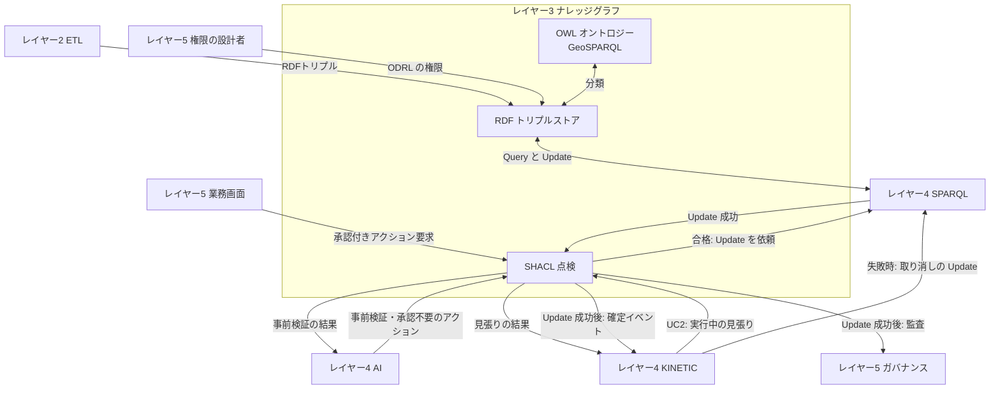

# レイヤー3　ナレッジグラフ

「何が何と同じで、何が何につながり、何をしてよいか」を機械が扱える形で持つ層です。図の Foundry Ontology は、この役の製品名です。ここではオントロジー（言葉の定義）、トリプルストア（データの保管）、SHACL（書き込む前と実行中の点検）の三つに分かれています。

ベテランの店員や設備担当が頭の中でしている判断の部分が、この層の OWL です。たとえば「A社と同じ1Lの無調整牛乳はどれか」（UC1）、「ピークの時間に止めたりずらしたりできる設備はどれか」（UC2）、「今夜の帰り便が立ち寄れる店はどこか」（UC3）です。食品安全、設備操作、在庫移動、値引き、承認のルールを守っているかは、この層の SHACL が点検します。

前後: [レイヤー2 セマンティックETL](layer-2.md) / [レイヤー4 AI推論とキネティック実行](layer-4.md)

## 図にあるもの

GraphDB、Stardog、Neptune はトリプルストアの実装候補で、どれか一つです。

| 名前 | ひとことで | この層での役割 |
| --- | --- | --- |
| オントロジー | 種類と関係の辞書 | 商品、店、ロット、設備、車両が何であり、どう結ばれるかを定義する |
| OWL 2 | その辞書の標準言語 | 代替候補、動かせる設備、立ち寄れる店を、定義から分類する |
| SKOS | 用語のゆるい階層 | 牛乳の区分、温度帯、日配品・惣菜のような呼び分けを表す |
| GS1 | 商品や場所の国際的な識別 | 商品のバーコード（GTIN）や、店の国際的な番号のように、社外と共有できる ID |
| Brick | 建物の設備のための公開オントロジー | 空調機、照明ゾーン、冷蔵ケース、電力メーター、センサーのような設備の種類と、「どの設備に付くか」「どの区画を受け持つか」の関係を表す |
| GeoSPARQL | 場所とルートの標準 | 店の位置、予報の地域、配送ルートを表し、「ルートから1km以内」を問い合わせる |
| UnifiedSKU | 卸売事業と小売事業で共通の商品 | 別コードの同じ商品を一つにまとめる。ID は GS1商品コードから作る |
| Store | 店と拠点 | どの店・DC の話かを表す。小売の店も卸の店も同じ種類 |
| Batch | ロット | いつの製造・入荷のまとまりかを表す |
| Equipment | 設備 | 空調機、照明ゾーン、冷蔵ケース、冷凍ケース、電力メーター、センサー。Brick の種類を使う |
| 温度帯 | 冷凍・冷蔵・常温 | 商品と設備と車両に付け、合うかどうかを比べる |
| RDF トリプルストア | 三つ組のデータベース | 人が書いた定義、レイヤー2が読み取った文、点検に合格した更新を保管する。代替や動かせる設備は問い合わせのときに計算する |
| RDF 1.2 | 三つ組の標準 | 主語・述語・目的語で事実を書く |
| RDF-star | 事実についての事実 | 「この関係は、この根拠で言える」を三つ組の上に書ける。このユースケースでは使わない |
| URI | 一つひとつに付く固定の ID | 商品、店、設備、車両、注文を、システムをまたいで指す |
| SHACL | 形と禁止事項のチェックリスト | 通過したものだけを更新してよい。実行中の状態の見張りにも使う。点検の一覧は [SHACL の定義](#shacl-の定義) |

## RDFトリプルストアの中身

ストアの中身は、商品テーブルではありません。主語・述語・目的語の文が、一つの置き場に並んでいます。ID は説明用です。保存する文は、次の5種類です。

| 種類 | 誰が置くか | いつ増えるか |
| --- | --- | --- |
| オントロジーの定義 | 人 | 言葉の定義や方針を変えたとき |
| SHACL の定義 | 人 | 点検規則を変えたとき |
| 権限の定義（ODRL） | レイヤー5の権限の設計者 | 誰が何を承認できるかを変えたとき |
| レイヤー2が読み取った文 | レイヤー2の RML | マスタ、台帳、棚割、顧客、注文、店間移動の行が来たとき。ロット、設備の運転状態、センサー、電力メーター、予報、売価、ルートは最新の1件を差し替える |
| 合格した更新 | レイヤー4の SPARQL Update | SHACL に合格したとき（注文の差し替え、調整計画、店間移動、見切り）。KINETIC が失敗した変更を取り消すときも、この Update で差し替える |

販売明細、温度と電力の連続記録、在庫移動や発注の履歴、注文の変更履歴、今の店頭在庫の本数、今日の販売数は入れません。履歴はレイヤー2が履歴の蓄積先へ送り、店頭在庫と販売数は POS が答えます。承認、自動で確定した規則、取り消し、元に戻した操作の来歴はレイヤー5の監査グラフに PROV-O で残し、このストアの文にはしません。

文は Named Graph（名前の付いたまとまり）に分けて置きます。商品、店・設備・車両、注文と店間移動、権限を分けると、レイヤー5の ODRL で「誰がどのまとまりを見てよいか」を掛けられます。

### オントロジーの定義

人が一度書く文です。データの行からは作りません。

| 主語 | 述語 | 目的語 | 図のどれか | 使うユースケース |
| --- | --- | --- | --- | --- |
| UnifiedSKU | 種類 | 商品の共通ID | UnifiedSKU | すべて |
| UnifiedSKU | ID の作り方 | GS1商品コードが同じ商品は、同じ UnifiedSKU | UnifiedSKU、GS1 | すべて |
| Store | 種類 | 店と拠点 | Store | すべて |
| Batch | 種類 | ロット | Batch | ― |
| 空調機 | 受け持つもの | 売場の区画 | Equipment、Brick | UC2 |
| 照明ゾーン | 種類 | 設備（Brick の照明） | Equipment、Brick | UC2 |
| 冷蔵ケース | 種類 | 設備（Brick の冷蔵設備） | Equipment、Brick | UC1、UC2 |
| 冷凍ケース | 種類 | 設備（Brick の冷凍設備） | Equipment、Brick | UC2 |
| 電力メーター | 測るもの | 店の受電点のデマンド | Equipment、Brick | UC2 |
| 温度センサー | 取り付け先 | 設備、または売場の区画 | Equipment、Brick | UC2 |
| 冷蔵 | 属する体系 | 温度帯（0〜5℃） | 温度帯、SKOS | すべて |
| 冷凍 | 属する体系 | 温度帯（−18℃以下） | 温度帯、SKOS | UC2 |
| 無調整 | 属する区分体系 | 牛乳の区分 | SKOS | UC1 |
| 日配品、惣菜 | 属する体系 | 期限の短い商品の区分 | SKOS | UC3 |
| 代替の候補 | 一致させる項目 | 容量、区分、温度帯 | OWL 2 | UC1 |
| 代替の候補 | 区分の属する体系 | 牛乳の区分（元の商品と同じ） | OWL 2、SKOS | UC1 |
| ピークに動かせる設備 | 条件 | 動かせる幅が台帳にあり、ピークの時間に電力を使う予定がある設備（霜取りの予定、空調、照明、冷凍ケース） | OWL 2 | UC2 |
| 立ち寄れる店 | 条件 | 今夜の配送ルートから1km以内にあり、営業中の店 | OWL 2、GeoSPARQL | UC3 |
| 近くの店 | 条件 | 互いに5km以内の小売の店 | OWL 2、GeoSPARQL | UC3 |
| 欠品代替の方針 | 代替後の支払額 | 元の注文の支払額のまま | OWL 2 | UC1 |
| 欠品代替の方針 | 差額の負担 | 店舗 | OWL 2 | UC1 |
| 電力ピークの方針 | 削る順 | 霜取りをずらす、冷凍ケースの予冷、空調、照明の順。売場の快適さに響くものほど後 | OWL 2 | UC2 |
| 在庫融通の方針 | 運び方 | ネットスーパー配送車の帰り便だけ。新しい便は出さない | OWL 2 | UC3 |
| 在庫融通の方針 | 移せない商品 | 期限が今日の商品は移さず、見切りにする | OWL 2 | UC3 |
| 商品コード | 書き方 | GS1 の商品識別 | GS1 | すべて |
| 店コード | 書き方 | GS1 の拠点識別 | GS1 | すべて |

商品の文には「牛乳である」という分類の文はありません。区分の「無調整」が SKOS で「牛乳の区分」に属しているので、区分を見れば牛乳だとわかります。

方針は、レイヤー4の AI が提案を作るときに読む決まりです。UC1 の「240円のまま、差額は店舗負担」は欠品代替の方針から、UC2 の A〜D の順は電力ピークの方針から、UC3 の帰り便の使い方は在庫融通の方針から生まれます。方針どおりでもルールを外れていないかは、SHACL が止めます。

### SHACL の定義

点検の規則も、人が書いて置く文です。オントロジーとは別です。アクションが来るより前から入っていて、合格・不合格のたびに増えません。

| 点検 | 見るもの | 超えてはいけない・満たすべきこと | 使うユースケース |
| --- | --- | --- | --- |
| 乳成分の一致 | 代替品のアレルギー成分 | 元の商品のアレルギー成分と同じ | UC1 |
| 支払額上限 | 提案後の注文の支払額 | 注文の承諾済み上限額以下 | UC1 |
| 値引上限 | 店舗負担の差額（代替品の通常価格 − 支払額） | 代替品の通常価格の20%以下 | UC1 |
| 食品安全 | ケースと車の温度（見込みと実測） | 中の商品の温度帯の中。冷蔵は0〜5℃、冷凍は−18℃以下 | UC2、UC3 |
| 霜取りの間隔 | 冷蔵ケースの霜取りの予定 | 前の霜取りから8時間以内 | UC2 |
| 売場の快適性 | 売場の区画の温度（見込みと実測） | 27℃以下 | UC2 |
| 設備操作の範囲 | BMS への設定 | 下の「自動で動かしてよい範囲」の中。外なら店長の承認が要る | UC2 |
| 在庫移動ルール | 移す商品、車、移動元 | 温度帯が同じ。期限まで1日以上。輸送時間が車の保冷時間以内。車の空きが足りる。移動元にネットスーパーの引当分が残る | UC3 |
| 見切りの値引上限 | 見切りの対象と値引き率 | 期限が今日の商品だけ。閉店の3時間前から。最大50% | UC3 |
| 承認 | アクションの種類と、付いている承認 | 下の表の承認者が付いている。承認者は権限の定義（ODRL）でその権限を持つ | すべて |

自動で動かしてよい範囲（値は説明用）は、次のとおりです。

| 設備 | 自動で動かしてよい範囲 |
| --- | --- |
| 冷蔵ケースの霜取り | 時刻を前後に動かしてよい。間隔は8時間以内 |
| 冷凍ケース | 設定温度は −24〜−18℃。出力は半分まで |
| 空調 | 設定温度は 24〜26℃ |
| 照明 | 窓際のゾーンだけ、30%まで調光 |
| 元に戻す操作 | いつでもよい（安全側） |

SHACL という名前は、この規則と、規則を実行する点検係の両方を指します。点検係はストアの中の規則を読みます。

SHACL の点検は、使う場面が三つあります。

| いつ | 誰が頼むか | 何を点検するか | 合格したら |
| --- | --- | --- | --- |
| 事前検証（承認を求める前） | レイヤー4の AI | 提案の中身。承認以外の、そのアクションに関わる点検 | 結果を AI に返すだけ。承認が要らないアクションなら、そのまま Update の依頼へ |
| 再検証（承認のあと） | レイヤー5の業務画面 | 事前検証と同じ点検 ＋ 承認 | SPARQL Update の依頼。Update の成功が返ってきたら、監査イベントと KINETIC への確定イベント |
| 見張り（実行中） | レイヤー4の KINETIC | ストアにある最新の観測（UC2 の売場、冷蔵ケース、冷凍ケースの温度） | 何も出さない。違反があれば、どの規則の、どのセンサーかを KINETIC に返す |

再検証するのは、承認を待つあいだに価格、注文、在庫の見込みが変わっているかもしれないからです。見張りは、提案のときの見込みが外れていないかを、実際の値で確かめるためです。

### 承認の要否

| アクション | 承認する人 | ユースケース |
| --- | --- | --- |
| 注文の商品の代替 | お客さん | UC1 |
| 方針の範囲内の設備の調整 | 不要 | UC2 |
| 方針の範囲外の設備の調整（空調27℃以上、生鮮売場の照明など） | 店長 | UC2（この例では出ない） |
| 設備を元に戻す操作 | 不要。安全側の操作 | UC2 |
| 店間移動（50個以下かつ15,000円以下） | 不要 | UC3 |
| 店間移動（上限を超える） | 受け入れる店の店長 | UC3 |
| 店間移動の数量を減らす | 不要 | UC3 |
| 見切りの値引き（上限内） | 不要 | UC3 |
| 失敗した変更の取り消し | 不要。SHACL も通さない | UC1 |

承認者が「店長」であることは、ODRL の権限の定義で確かめます。たとえば「2号店の店長は、2号店が受け入れる店間移動を承認できる」です。毎日起きることなので、方針の範囲内は人の承認なしで動き、人は例外だけを見ます。

### レイヤー2が読み取った文

基幹システムから RML が読み取った行です。どの種類も、ここに入るまでの手順は同じです。違うのは、読み取る列と、主語になる列です。

#### 商品マスタ

主語は商品コードです。使う列は、名前、容量、区分、温度帯、アレルギー成分、通常価格、GS1商品コードです。UnifiedSKU への対応は、GS1商品コードから作ります。

ネットスーパーの注文は小売側のコードを使うので、ここでは小売側の2商品を示します。

| 主語 | 述語 | 目的語 |
| --- | --- | --- |
| 商品 R-5502 | 名前 | A社 おいしい牛乳 |
| 商品 R-5502 | 容量 | 1L |
| 商品 R-5502 | 区分 | 無調整 |
| 商品 R-5502 | 温度帯 | 冷蔵 |
| 商品 R-5502 | アレルギー成分 | 乳 |
| 商品 R-5502 | 通常価格 | 240 |
| 商品 R-5502 | GS1商品コード | 4900000000085 |
| 商品 R-5502 | 同じ商品 | UnifiedSKU U-4900000000085 |
| 商品 R-5581 | 名前 | B社 オーガニック牛乳 |
| 商品 R-5581 | 容量 | 1L |
| 商品 R-5581 | 区分 | 無調整 |
| 商品 R-5581 | 温度帯 | 冷蔵 |
| 商品 R-5581 | アレルギー成分 | 乳 |
| 商品 R-5581 | 通常価格 | 285 |
| 商品 R-5581 | GS1商品コード | 4900000000023 |
| 商品 R-5581 | 同じ商品 | UnifiedSKU U-4900000000023 |

卸側の `W-10086`（A社）と `W-10022`（B社）も、同じ形の文を持ちます。GS1商品コードが同じなので、`W-10086` と `R-5502` は `U-4900000000085` を、`W-10022` と `R-5581` は `U-4900000000023` を指します。グラフでは、それぞれ一つの商品として探せます。

UC3 で使うヨーグルト（R-6120）と弁当（R-8104）も同じ形です。ヨーグルトには「日配品」、弁当には「惣菜」の区分の文が付きます。

#### 注文

主語は注文番号です。使う列は、対象商品、支払額、承諾済み上限額、出荷店、配達枠です。レジ明細の全行は読み取りません。

| 主語 | 述語 | 目的語 |
| --- | --- | --- |
| 注文 8841 | 対象商品 | 商品 R-5502 |
| 注文 8841 | 支払額 | 240 |
| 注文 8841 | 承諾済み上限額 | 240 |
| 注文 8841 | 出荷店 | 店 ST-014 |
| 注文 8841 | 配達枠 | 15:00〜16:00 |

承諾済み上限額は、お客さんが注文の時点で払うと決めた額です。B社の通常価格 285 は商品 `R-5581` の文のままです。注文 `8841` の支払額 240 は、この注文でお客さんが払う金額です。

#### 店、設備、車両

主語は店コード、設備 ID、車両 ID です。店は SAP の拠点マスタ、設備は CMMS の設備台帳、車両は TMS から入ります。

| 主語 | 述語 | 目的語 | 出どころ |
| --- | --- | --- | --- |
| 店 ST-014 | 名前 | 1号店 | 拠点マスタ |
| 店 ST-014 | 位置 | 地図上の点（GeoSPARQL） | 拠点マスタ |
| 店 ST-014 | 閉店時刻 | 22:00 | 拠点マスタ |
| 電力メーター EM-014 | 置かれた店 | 店 ST-014 | 設備台帳 |
| 電力メーター EM-014 | 契約電力 | 800kW | 設備台帳 |
| 空調機 AHU-2 | 受け持つもの | 区画 窓際の惣菜コーナー | 設備台帳 |
| 空調機 AHU-2 | 動かせる幅 | 設定温度 24〜26℃ | 設備台帳 |
| センサー ZT-2 | 取り付け先 | 区画 窓際の惣菜コーナー | 設備台帳 |
| 設備 RC-03 | 種類 | 冷蔵ケース | 設備台帳 |
| 設備 RC-03 | 温度帯 | 冷蔵 | 設備台帳 |
| 設備 RC-03 | 霜取りの消費電力 | 4kW | 設備台帳 |
| 設備 FZ-01 | 種類 | 冷凍ケース | 設備台帳 |
| 設備 FZ-01 | 温度帯 | 冷凍 | 設備台帳 |
| 商品 R-5581 | 並ぶ設備 | 設備 RC-03 | 棚割 |
| 車両 V-14 | 所属 | 店 ST-014 | TMS |
| 車両 V-14 | 温度帯 | 冷蔵 | TMS |
| 車両 V-14 | 保冷時間 | 2時間 | TMS |

#### 最新の状態

主語ごとに最新の1件だけを置き、新しい値が来たら差し替えます。次は UC2 の 12:30 と、UC3 の 16:00 の時点の例です。

| 主語 | 述語 | 目的語 | 出どころ |
| --- | --- | --- | --- |
| 電力メーター EM-014 | 最新の観測 | 12:15〜12:30 のデマンド 745kW | 電力メーター |
| 予報東部地域/今日14:00 | 結果 | 外気温 37℃ | 気象局 |
| 設備 RC-03 | 霜取りの予定 | 08:00、14:00、20:00 | BMS |
| センサー ZT-2 | 最新の観測 | 観測 ZT-2/12:30（24.8℃） | 温度センサー |
| 車両 V-14 | 今夜のルート | 線（GeoSPARQL）。2号店の地区の配達 17:00〜17:40 | TMS |
| 車両 V-14 | 空き | 80% | TMS |

### 推論の結果は保存しない

`R-5502` も `R-5581` も、すでに「容量は 1L」「区分は無調整」を持っています。オントロジーには「代替の候補は、元の商品と同じ容量・同じ区分・同じ温度帯の牛乳」と書いてあります。OWL は問い合わせのとき、A社と同じ値を持つ商品を候補として返します。卸側のコードは同じ UnifiedSKU なので、候補は UnifiedSKU ごとに一つにまとまります。ネットスーパーの注文は小売側のコードを使うので、問い合わせは候補を注文と同じ小売側のコード（`R-5581`）で返します。

UC2 の「ピークに動かせる設備」、UC3 の「立ち寄れる店」も同じです。設備台帳、霜取りの予定、今夜のルートから、問い合わせのたびに計算します。

「分類は代替の候補」「ピークに動かせる設備」「V-14 が立ち寄れる店」という文は、ストアに足しません。元の値が変わったあと、古い分類が残るのを避けるためです。確定した調整計画や店間移動は推論の結果ではなく、合格した更新として入ります。

## インプット

| どこから | 何が入るか | どの箱が受け取るか |
| --- | --- | --- |
| オントロジーの作成者 | 種類、温度帯、代替・動かせる設備・立ち寄れる店を判断する定義、欠品代替・電力ピーク・在庫融通の方針 | OWL |
| ルールの作成者 | 乳成分、支払額、値引上限、食品安全、霜取りの間隔、売場の快適性、設備操作の範囲、在庫移動、見切り、承認 | SHACL |
| レイヤー5 権限の設計者 | 誰が何を承認できるか（ODRL） | RDF（権限の Named Graph） |
| レイヤー2 ETL | 商品マスタ、店・設備・車両の台帳、棚割、顧客、注文、店間移動と、ロット・設備・センサー・電力メーター・予報・売価・ルートの最新の状態 | RDF |
| レイヤー4 SPARQL | 代替、動かせる設備、立ち寄れる店を探す問い合わせ（Query と GeoSPARQL）と、方針の読み取り | RDF。OWL の定義と合わせて答える |
| レイヤー4 AI | 事前検証の依頼。承認が要らないアクションの要求 | SHACL |
| レイヤー5 業務画面 | 承認付きアクション要求 | SHACL |
| レイヤー4 KINETIC | 実行中の見張りの依頼（UC2） | SHACL |
| レイヤー4 SPARQL Update | 合格した変更。失敗したときの取り消し（KINETIC から） | RDF |
| レイヤー4 SPARQL | Update の成功の応答 | SHACL。監査と確定イベントを出す合図 |

## アウトプット

| どこへ | 何が出るか | 条件 |
| --- | --- | --- |
| レイヤー4 SPARQL | 代替候補、動かせる設備と幅、立ち寄れる店 | 問い合わせに対する OWL と GeoSPARQL の結果 |
| レイヤー4 SPARQL | グラフの検索結果全般と、方針。画面や AI が読む | Query の応答 |
| レイヤー4 AI | 事前検証の結果。不合格なら、どの点検に落ちたか | 事前検証のとき |
| レイヤー4 SPARQL | 合格した変更を書き込む Update の依頼 | 再検証に合格したとき。承認が要らないアクションは事前検証に合格したとき |
| レイヤー4 KINETIC | 変更が確定したというイベント | Update の成功が返ってきたとき。書き戻しの起点 |
| レイヤー4 KINETIC | 見張りの結果。違反した規則とセンサー | 見張りのとき |
| レイヤー5 ガバナンス | 監査イベント。誰が、いつ、何を承認したか。承認が要らないアクションは、どの規則で自動にしたか | Update の成功が返ってきたとき |

点検が不合格のときは、Update、監査記録、確定イベントは出ません。アクション要求は却下で終わり、AI は不合格の理由を見て案を直せます。Update が失敗したときも、監査記録と確定イベントは出しません。

OWL と RDF のあいだの矢印は双方向です。定義がデータを分類し、データの追加が次の分類の材料になります。RDF と SPARQL のあいだも双方向で、読み取り（Query）と、合格後の書き込み（Update）の両方です。

## ユースケースごとの動き

### UC1 ネットスーパーの欠品代替

この層が受け取る問いは「A社 おいしい牛乳 1L（R-5502）と同じ容量・同じ区分・同じ温度帯の代替はどれか」です。OWL が B社オーガニック牛乳（R-5581）を返します。在庫ありかどうかは、ネットスーパーアプリが POS に確認します。

AI が欠品代替の方針から作る提案は、新しい注文を作ることではありません。すでに入っている対象商品を、A社から B社へ変えてよいかです。

| 項目 | 値 |
| --- | --- |
| 注文 | 8841 |
| いまの対象 | 商品 R-5502（A社 おいしい牛乳） |
| 変えたい対象 | 商品 R-5581（B社 オーガニック牛乳） |
| 支払額 | 240円のまま |
| 店舗負担の差額 | 45円（285 − 240） |

| 点検 | 見ている文 | 結果 |
| --- | --- | --- |
| 乳成分の一致 | R-5502 のアレルギー成分は乳、R-5581 も乳 | 合格 |
| 支払額上限 | 提案後の支払額は 240、注文 8841 の承諾済み上限額は 240 | 合格 |
| 値引上限 | 差額は 45、上限は R-5581 の通常価格 285 の20%で 57 | 合格 |
| 承認（再検証だけ） | 14:22 のお客さん自身の1タップ | 合格 |

再検証に合格すると、レイヤー4の SPARQL が Update で対象商品の文だけを差し替え、成功を SHACL に返します。ほかの文はそのままです。

| 主語 | 述語 | 目的語 |
| --- | --- | --- |
| 注文 8841 | 対象商品 | 商品 R-5581 |

不合格なら、対象商品は `R-5502` のままです。KINETIC が POS で B社の牛乳を引き当てられなかったときは、KINETIC が SPARQL Update で対象商品を `R-5502` に戻します。

### UC2 電力ピークの自動調整

この層が受け取る問いは「1号店で、14:00〜15:00 に電力を減らせる設備と、その幅はどれか」です。デマンドの見込み（830kW）は、レイヤー4の AI が予報と直近のデマンドから見積もります。OWL は次を返します。

| 推論 | 使う文 | 結果 |
| --- | --- | --- |
| 霜取りがピークに重なる設備 | 霜取りの予定が 14:00 の冷蔵ケース | RC-01〜12 の12台（1台4kW） |
| 予冷できる設備 | 冷凍ケースで、動かせる幅が台帳にある | FZ-01 |
| 設定を変えられる設備 | 空調機と、その動かせる幅 | AHU-1〜3（24〜26℃） |
| 調光できる設備 | 窓際の照明ゾーン | LZ-4 |

AI が電力ピークの方針の順で作った案 A〜D の事前検証は、次のとおりです。すべて自動で動かしてよい範囲なので、承認は要りません。

| アクション | 点検 | 見込み | 結果 |
| --- | --- | --- | --- |
| A. 霜取りを 12:45 と 15:15 の6台ずつへ | 霜取りの間隔 | 最長 7時間15分（08:00 → 15:15） | 合格 |
| B. FZ-01 を 13:00〜14:00 に −22℃ へ予冷、14:00〜15:00 は出力を半分 | 食品安全 | 15:00 に −19℃（−18℃以下） | 合格 |
| C. 空調を 14:00〜15:00 だけ 26℃ | 売場の快適性、設備操作の範囲 | 売場は最高 26.8℃。26℃は 24〜26℃ の中 | 合格 |
| D. LZ-4 を 30% 調光 | 設備操作の範囲 | 窓際のゾーンで30% | 合格 |

合格すると、SPARQL Update で今日の調整計画が入ります。

| 主語 | 述語 | 目的語 |
| --- | --- | --- |
| 調整計画 PS-014 | 対象の時間 | 今日 14:00〜15:00 |
| 調整計画 PS-014 | 見込みのデマンド | 762kW |
| 設備 RC-01〜06 | 霜取りの予定 | 08:00、12:45、20:00 |
| 設備 RC-07〜12 | 霜取りの予定 | 08:00、15:15、20:00 |
| 設備 FZ-01 | 時刻つきの設定 | 13:00〜14:00 は −22℃、14:00〜15:00 は出力半分 |
| 空調機 AHU-1〜3 | 時刻つきの設定 | 14:00〜15:00 は 26℃ |
| 照明ゾーン LZ-4 | 時刻つきの設定 | 14:00〜15:00 は 30% 調光 |

14:00〜15:00 のあいだ、KINETIC が5分ごとに見張りを頼みます。SHACL は、売場の快適性と食品安全を、ストアにある最新の観測で点検します。14:20 に ZT-2 の最新の観測が 27.2℃ になり、売場の快適性に違反します。違反の結果には「規則: 売場の快適性、センサー: ZT-2、受け持つ空調機: AHU-2」が入ります。

KINETIC の依頼を受けた AI が「AHU-2 だけ 25℃ に戻す」を出すと、元に戻す操作なので承認なしで合格し、Update で AHU-2 の時刻つきの設定が消えます。ほかの空調機の 26℃ はそのままです。

### UC3 夕方の在庫融通と見切り

この層が受け取る問いは2つです。1つ目は「1号店の近くの店と、そこで扱う日配品と惣菜はどれか」、2つ目は「今夜の帰り便のルートから1km以内に、受け入れる店はあるか」です。店頭在庫、期限ごとの内訳、今日の販売数は、AI が POS に聞きます。OWL と GeoSPARQL は次を返します。

| 推論 | 使う文 | 結果 |
| --- | --- | --- |
| 近くの店 | 店の位置 | 1号店、2号店（4km）、3号店（2号店から5km） |
| 立ち寄れる店 | V-14 の今夜のルート | 2号店（ルートから0.3km、17:50 に立ち寄れる） |
| 立ち寄れる店 | V-40 の今夜のルート | 2号店（ルートから0.8km、18:10 に立ち寄れる） |

AI が在庫融通の方針で作った案 A〜C の事前検証は、次のとおりです。

| アクション | 点検 | 見ている値 | 結果 | 承認 |
| --- | --- | --- | --- | --- |
| A. 牛乳20本: 1号店 → 2号店（V-14） | 在庫移動ルール | 冷蔵の車。期限は明日。輸送20分（保冷2時間）。車の空き80%。1号店に引当6本が残る（46 − 20 = 26） | 合格 | 不要（20本、5,700円） |
| B. ヨーグルト55個: 3号店 → 2号店（V-40） | 在庫移動ルール | 冷蔵の車。期限は明日。輸送15分 | 合格 | 55個で上限超え。2号店の店長 |
| C. 弁当の見切り（3号店） | 見切りの値引上限 | 期限は今日。19:00 は閉店の3時間前。最大50% | 合格 | 不要 |

A と C はそのまま、B は 16:15 の店長の承認と再検証のあとに、SPARQL Update で次の文が入ります。

| 主語 | 述語 | 目的語 |
| --- | --- | --- |
| 店間移動 T-1601 | 内容 | 商品 R-5581 を20本、店 ST-014 → 店 ST-031 |
| 店間移動 T-1601 | 運ぶ車 | 車両 V-14（17:50 着） |
| 店間移動 T-1602 | 内容 | 商品 R-6120 を55個、店 ST-040 → 店 ST-031 |
| 店間移動 T-1602 | 運ぶ車 | 車両 V-40（18:10 着） |
| 見切り M-1603 | 内容 | 店 ST-040 の商品 R-8104 を、19:00 から30%引き、20:30 から50%引き |

17:05 に1号店で牛乳が18本しか見つからないと、AI が「T-1601 を18本に減らす」を出します。減らすだけなので承認なしで合格し、Update で T-1601 の本数が18本になります。

## 入出力の図

