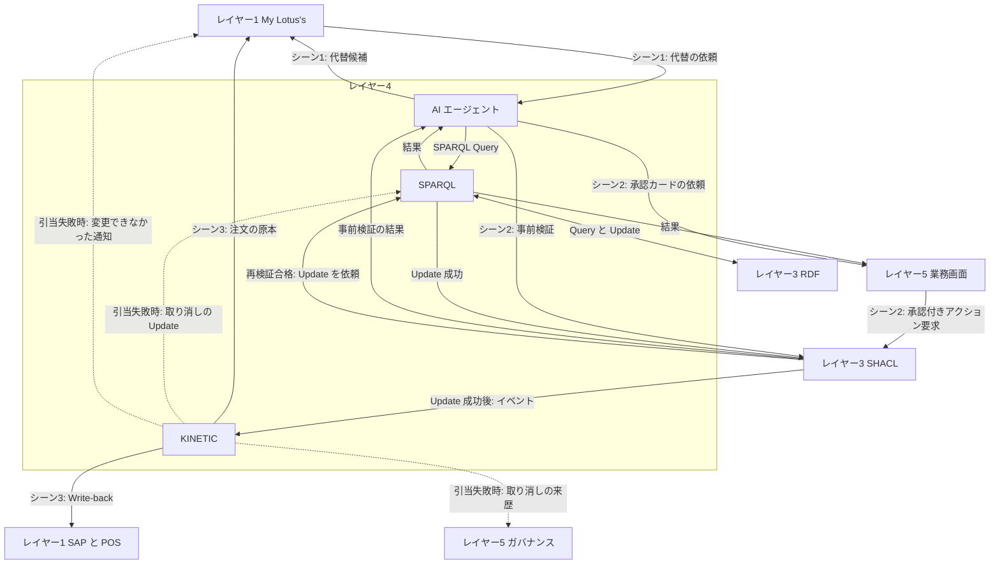

# レイヤー4　AI推論とキネティック実行

人が言葉で頼んだことをグラフへの問い合わせに変え、点検を通過した決定を基幹システムまで届ける層です。図の AIP は問い合わせや提案、Actions は決定の実行に相当する製品の呼び名です。

この層は店頭在庫を持ちません。代替の候補をレイヤー3に尋ねて提案を作り、合格した変更の実行係になります。

前後: [レイヤー3 ナレッジグラフ](layer-3.md) / [レイヤー5 業務画面とガバナンス](layer-5.md)

## 図にあるもの

Temporal と Camunda は、仕事の進行役の実装候補で、どれか一つです。

| 名前 | ひとことで | この層での役割 |
| --- | --- | --- |
| GraphRAG | グラフを調べてから答える AI | 先に該当する三つ組を探し、その範囲で提案を作る |
| AIエージェント | 手順を踏んでツールを呼ぶプログラム | 代替の問い合わせ、欠品代替の方針に沿った提案づくり、事前検証の依頼、承認カードの依頼を順番に行う |
| Amazon Bedrock | 生成 AI のモデルを呼ぶ AWS のサービス | エージェントが、依頼の文の理解と SPARQL の生成に使うモデル |
| LangGraph | エージェントの手順を書く枠組み | どの順で SPARQL や点検を呼ぶかを定義する |
| MCP | ツールを呼ぶ共通のつなぎ方 | エージェントが SPARQL や SHACL、業務画面を、決まった口で呼べるようにする |
| 自然言語から SPARQL | 人の文をグラフの問い合わせに変換する | 「A社と同じ容量・同じ区分」を Query の条件にする |
| SPARQL 1.1 Query | グラフを読む問い合わせ | 代替候補や、画面に出す事実を RDF から取る |
| SPARQL 1.1 Update | グラフを書き換える文 | 再検証の合格後、注文の対象商品を LS-5581 へ差し替える |
| フェデレーション | 複数のグラフを一つの問い合わせで扱う | RDF トリプルストアに対する Query と Update の窓口。この例の問い合わせ先はトリプルストア一つ |
| KINETIC | 決定を現場のシステムへ届ける進行役 | シーン3の書き戻しを、途中で落ちても続きから進める |
| Temporal | プログラムとして工程を書くエンジン | 停止しても状態を覚えて再開する |
| Camunda | 図として工程を書くエンジン | BPMN の工程を実行する |
| CloudEvents | 出来事を包む共通の封筒 | 「注文の代替が確定した」を KINETIC が受け取れる形にする |
| BPMN 2.0 | 業務手順の図の標準 | 書き戻しの順序を表す |
| BAPI | SAP の関数呼び出し | SAP の在庫引当と会計伝票を更新する |
| Webhook | 相手の URL へ事実を送る通知 | POS（ピッカー端末を含む）と My Lotus's へ変更を届ける |
| Write-back | 決定を原本のシステムへ反映すること | シーン3の出口 |

Bedrock、LangGraph、MCP は組み合わせです。モデル、手順、ツールのつなぎ方、という三役です。Query と Update も、読むときと書くときの SPARQL として組み合わせます。CloudEvents は出来事の形、BPMN は手順の形です。BAPI と Webhook は、書き戻し先ごとの届け方です。

## インプット

| どこから | 何が入るか | どの箱が受け取るか |
| --- | --- | --- |
| レイヤー1 My Lotus's | シーン1の依頼。「欠品した A社牛乳（LS-5502）の代替はどれか」。在庫確認のあとは「B社は在庫あり。提案を作って」 | AI。自然言語の依頼として受け、SPARQL にする |
| レイヤー3 RDF | Query の結果。代替候補、欠品代替の方針（支払額は元のまま、差額は店舗負担）、画面用の事実 | SPARQL が受け、AI とレイヤー5へ渡す |
| レイヤー3 SHACL | 事前検証の結果 | AI |
| レイヤー3 SHACL | 再検証に合格した提案の Update の依頼 | SPARQL が RDF へ実行し、成功を SHACL に返す |
| レイヤー3 SHACL | 変更確定のイベント。Update の成功のあとに届く | KINETIC |
| レイヤー1 POS | 引当の結果（成功、または在庫なしで失敗） | KINETIC |

## アウトプット

| どこへ | 何が出るか | どの箱から出るか |
| --- | --- | --- |
| レイヤー3 RDF | 代替を探す SPARQL Query | SPARQL |
| レイヤー1 My Lotus's | 代替候補。「B社 オーガニック牛乳（LS-5581）」 | AI |
| レイヤー3 SHACL | シーン2の事前検証の依頼。「LS-5581 を80バーツのまま提供してよいか」 | AI |
| レイヤー5 業務画面 | 承認カードの依頼。提案の文面と、事前検証の結果 | AI |
| レイヤー3 RDF | 再検証合格後の SPARQL Update。注文の対象商品を B社へ変える | SPARQL |
| レイヤー3 SHACL | Update の成功の応答 | SPARQL |
| レイヤー5 UI1 と UI2 | Query の結果 | SPARQL |
| レイヤー1 の SAP、POS、My Lotus's | シーン3の Write-back | KINETIC |
| レイヤー3 RDF | 引当に失敗したときの取り消しの Update。注文の対象商品を A社へ戻す | KINETIC が SPARQL 経由で出す |
| レイヤー5 ガバナンス | 引当に失敗したときの取り消しの来歴 | KINETIC |
| レイヤー1 My Lotus's | 引当に失敗したときの「変更できませんでした」の通知 | KINETIC |

KINETIC が届けるシーン3の中身は次のとおりです。上から順に呼びます。

| 順番 | 届け先 | 中身 | 届け方 |
| --- | --- | --- | --- |
| 1 | POS（ピッカー端末を含む店舗システム） | B社の牛乳を1本引き当て、集品対象を B社の牛乳へ書き換える | Webhook |
| 2 | SAP | 在庫の引当と、差額15バーツを店舗負担とする会計伝票 | BAPI |
| 3 | My Lotus's（ネットスーパーの注文の原本） | 注文の対象商品を LS-5502 から LS-5581 へ変える | Webhook |
| ― | WMS | 牛乳の例では書き戻さない。在庫移動（STO）など別のアクションの書き戻し先 | Webhook |

ピッキング完了と配達出発は、KINETIC が出すものではありません。ピッカー端末と TMS が記録し、レイヤー1の中で My Lotus's に表示されます。

KINETIC は、これらの呼び出しが通信の失敗などで一部だけ成功して止まっても、完了していない先だけやり直せる進行役です。

## B社の引当に失敗したとき

在庫を確かめるのはシーン1の POS への問い合わせだけです。SHACL の再検証は店頭在庫を見ません（在庫はトリプルストアに入らないため）。そのため、承認を待つあいだに B社の牛乳が売れると、POS の引当で初めて失敗がわかります。在庫がないのはやり直しても直らないので、KINETIC は次の取り消しに進みます。

1. SAP と My Lotus's の注文の原本への書き戻しは行わない。POS の引当は1番目なので、ほかに戻す書き戻しはない。
2. SPARQL Update で、トリプルストアの注文 8841 の対象商品を `LS-5502` に戻す。合格した変更の取り消しなので、SHACL は通さない。
3. レイヤー5のガバナンスに、取り消しの来歴（いつ、なぜ戻したか）を残す。
4. My Lotus's に「代替品も品切れのため、変更できませんでした」と通知する。次の候補を探すときは、シーン1からやり直す。

## 牛乳が欠品したとき

1. My Lotus's が「A社は欠品。代替はどれか」と頼む。
2. AI がそれを SPARQL Query にし、レイヤー3が B社オーガニック牛乳を返す。AI は候補を My Lotus's に返す。
3. My Lotus's が POS で B社の在庫を確認し、「在庫あり」と AI に伝える。
4. AI がレイヤー3の欠品代替の方針（支払額は元のまま、差額は店舗負担）を読み、「80バーツのまま B社にする」案を作る。その案を SHACL に事前検証させ、合格したら業務画面に承認カードを頼む。
5. お客さんが承認し、SHACL の再検証に合格すると、SPARQL が Update で注文を書き換えて成功を返す。そのあと KINETIC が書き戻しを始める。

## 入出力の図

