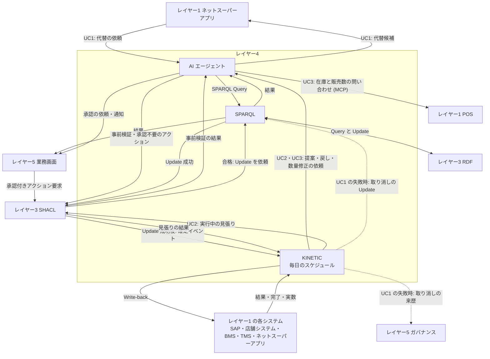

# レイヤー4　AI推論とキネティック実行

人の依頼や毎日のスケジュールをきっかけにグラフへ問い合わせて提案を作り、点検を通過した決定を基幹システムと店舗設備まで届ける層です。図の AIP は問い合わせや提案、Actions は決定の実行に相当する製品の呼び名です。

この層は店頭在庫を持ちません。在庫の本数や今日の販売数が要るときは POS に聞きます。候補や動かせる設備はレイヤー3に尋ねて提案を作り、合格した変更の実行係になります。

前後: [レイヤー3 ナレッジグラフ](layer-3.md) / [レイヤー5 業務画面とガバナンス](layer-5.md)

## 図にあるもの

Temporal と Camunda は、仕事の進行役の実装候補で、どれか一つです。

| 名前 | ひとことで | この層での役割 |
| --- | --- | --- |
| GraphRAG | グラフを調べてから答える AI | 先に該当する三つ組を探し、その範囲で提案を作る |
| AIエージェント | 手順を踏んでツールを呼ぶプログラム | 問い合わせ、見積もり、方針に沿った提案づくり、事前検証の依頼、承認の依頼を順番に行う。不合格なら理由を見て案を直す |
| Amazon Bedrock | 生成 AI のモデルを呼ぶ AWS のサービス | エージェントが、依頼の理解、SPARQL の生成、見積もり、計画づくりに使うモデル |
| LangGraph | エージェントの手順を書く枠組み | どの順で SPARQL、POS、点検、承認を呼ぶかを定義する |
| MCP | ツールを呼ぶ共通のつなぎ方 | エージェントが SPARQL、SHACL、業務画面、POS の在庫 API を、決まった口で呼べるようにする |
| 自然言語から SPARQL | 人の文をグラフの問い合わせに変換する | 「A社と同じ容量・同じ区分」「ルートから1km以内の店」を Query の条件にする |
| SPARQL 1.1 Query | グラフを読む問い合わせ | 候補、動かせる設備、方針、画面に出す事実を RDF から取る |
| GeoSPARQL | 場所の条件を足した SPARQL | UC3 で「近くの店」「ルートから1km以内」を問い合わせる |
| SPARQL 1.1 Update | グラフを書き換える文 | 合格した変更と、失敗したときの取り消しを書き込む |
| フェデレーション | 複数のグラフを一つの問い合わせで扱う | RDF トリプルストアに対する Query と Update の窓口。この構成の問い合わせ先はトリプルストア一つ |
| KINETIC | 決定を現場のシステムへ届ける進行役 | スケジュールでワークフローを起こし、承認や時刻を待ち、書き戻し、実行中を見張り、失敗や違反に応じて取り消しや戻しを頼む |
| Temporal | プログラムとして工程を書くエンジン | 毎日のスケジュール、時刻までの待ち、停止しても状態を覚えて再開する |
| Camunda | 図として工程を書くエンジン | BPMN の工程を実行する |
| CloudEvents | 出来事を包む共通の封筒 | 「変更が確定した」「作業が終わった」を KINETIC が受け取れる形にする |
| BPMN 2.0 | 業務手順の図の標準 | 書き戻しの順序と、待ちと分岐を表す |
| BAPI | SAP の関数呼び出し | SAP の引当、会計伝票、店間移動伝票を作る |
| Webhook | 相手の URL へ事実を送る通知 | 店舗システム、TMS、ネットスーパーアプリへ変更を届ける |
| BMS の制御コマンド | 設備への遠隔操作 | 霜取りのスケジュール、時刻つきの設定温度、出力、調光 |
| Write-back | 決定を原本のシステムへ反映すること | 書き戻しの出口 |

Bedrock、LangGraph、MCP は組み合わせです。モデル、手順、ツールのつなぎ方、という三役です。Query と Update も、読むときと書くときの SPARQL として組み合わせます。CloudEvents は出来事の形、BPMN は手順の形です。BAPI、Webhook、BMS の制御コマンドは、書き戻し先ごとの届け方です。

## KINETIC のワークフロー

KINETIC は、ユースケースごとに一つのワークフローを動かします。

| ワークフロー | 起こすもの | 待つもの | 書き戻し | 見張りと失敗したとき |
| --- | --- | --- | --- | --- |
| 欠品代替（UC1） | SHACL からの確定イベント | なし | POS、SAP、ネットスーパーアプリの順 | POS で引当できなければ取り消す |
| 電力ピーク対策（UC2） | 毎日 12:30 のスケジュール | 確定イベント | BMS（時刻つきの設定をまとめて） | 14:00〜15:00 は5分ごとに SHACL で見張る。違反した設備だけ AI に戻しを頼む |
| 夕方の在庫融通（UC3） | 毎日 16:00 のスケジュール | 確定イベント、店長の承認、作業の完了、19:00 と 20:30 の時刻 | SAP、TMS、店舗システム（スタッフ端末、POS、電子棚札） | 実際の数が足りなければ、AI に数量の修正を頼む |

UC2 と UC3 では、KINETIC が先にワークフローを起こし、AI に提案を頼みます。提案が SHACL に合格して確定すると、その確定イベントで同じワークフローの続きが動きます。UC1 では、AI がネットスーパーアプリから直接頼まれ、確定イベントでワークフローが始まります。

## インプット

| どこから | 何が入るか | どの箱が受け取るか |
| --- | --- | --- |
| レイヤー1 ネットスーパーアプリ（UC1） | 「欠品した A社牛乳（R-5502）の代替はどれか」。在庫確認のあとは「B社は在庫あり。提案を作って」 | AI。自然言語の依頼として受け、SPARQL にする |
| レイヤー4 KINETIC（UC2・UC3） | 毎日の調整案や融通の案の依頼。元に戻す操作、数量の修正の依頼 | AI |
| レイヤー1 POS（UC3） | 3店の店頭在庫（期限ごとの内訳）と今日の販売数 | AI（MCP 経由） |
| レイヤー3 RDF | Query の結果。候補、動かせる設備、立ち寄れる店、方針、予報、画面用の事実 | SPARQL が受け、AI とレイヤー5へ渡す |
| レイヤー3 SHACL | 事前検証の結果 | AI |
| レイヤー3 SHACL | 合格した変更の Update の依頼 | SPARQL が RDF へ実行し、成功を SHACL に返す |
| レイヤー3 SHACL | 変更確定のイベント。Update の成功のあとに届く | KINETIC |
| レイヤー3 SHACL | 見張りの結果（UC2） | KINETIC |
| レイヤー1 の各システム | 書き戻しの結果、作業の完了と実際の数、受け入れの完了、ピークの結果 | KINETIC |

## アウトプット

| どこへ | 何が出るか | どの箱から出るか |
| --- | --- | --- |
| レイヤー3 RDF | 候補、動かせる設備、立ち寄れる店を探す Query | SPARQL |
| レイヤー1 POS（UC3） | 店頭在庫と今日の販売数の問い合わせ | AI（MCP 経由） |
| レイヤー1 ネットスーパーアプリ（UC1） | 代替候補。「B社 オーガニック牛乳（R-5581）」 | AI |
| レイヤー3 SHACL | 事前検証の依頼と、承認が要らないアクションの要求 | AI |
| レイヤー3 SHACL | 実行中の見張りの依頼（UC2） | KINETIC |
| レイヤー5 業務画面 | 承認の依頼と、自動で確定した調整の通知 | AI |
| レイヤー3 RDF | 合格した変更の Update | SPARQL |
| レイヤー3 SHACL | Update の成功の応答 | SPARQL |
| レイヤー5 UI1 と UI2 | Query の結果 | SPARQL |
| レイヤー1 の各システム | 書き戻し。中身は [レイヤー1](layer-1.md#インプット) の表 | KINETIC |
| レイヤー3 RDF | 失敗したときの取り消しの Update（UC1） | KINETIC が SPARQL 経由で出す |
| レイヤー5 ガバナンス | 取り消しの来歴（UC1） | KINETIC |

## ユースケースごとの動き

### UC1 ネットスーパーの欠品代替

1. ネットスーパーアプリが「A社は欠品。代替はどれか」と頼む。
2. AI がそれを SPARQL Query にし、レイヤー3が B社オーガニック牛乳を返す。AI は候補をネットスーパーアプリに返す。
3. ネットスーパーアプリが POS で B社の在庫を確認し、「在庫あり」と AI に伝える。
4. AI がレイヤー3の欠品代替の方針（支払額は元のまま、差額は店舗負担）を読み、「240円のまま B社にする」案を作る。その案を SHACL に事前検証させ、合格したら業務画面に承認カードを頼む。
5. お客さんが承認し、SHACL の再検証に合格すると、SPARQL が Update で注文を書き換えて成功を返す。そのあと KINETIC の「欠品代替」ワークフローが始まる。

KINETIC は次の順に呼びます。

| 順番 | 届け先 | 中身 | 届け方 |
| --- | --- | --- | --- |
| 1 | 店舗システム（POS とスタッフ端末） | B社の牛乳を1本引き当て、ピッキング対象を B社の牛乳へ書き換える | Webhook |
| 2 | SAP | 在庫の引当と、差額45円を店舗負担とする会計伝票 | BAPI |
| 3 | ネットスーパーアプリ（注文の原本） | 注文の対象商品を R-5502 から R-5581 へ変える | Webhook |

在庫を確かめるのはシーン1の POS への問い合わせだけです。SHACL の再検証は店頭在庫を見ません（在庫はトリプルストアに入らないため）。そのため、承認を待つあいだに B社の牛乳が売れると、POS の引当で初めて失敗がわかります。在庫がないのはやり直しても直らないので、KINETIC は次の取り消しに進みます。

1. SAP とネットスーパーアプリへの書き戻しは行わない。POS の引当は1番目なので、ほかに戻す書き戻しはない。
2. SPARQL Update で、注文 8841 の対象商品を `R-5502` に戻す。合格した変更の取り消しなので、SHACL は通さない。
3. レイヤー5のガバナンスに、取り消しの来歴（いつ、なぜ戻したか）を残す。
4. ネットスーパーアプリに「代替品も品切れのため、変更できませんでした」と通知する。次の候補を探すときは、最初からやり直す。

ピッキング完了と配達出発は、KINETIC が出すものではありません。スタッフ端末と TMS が記録し、レイヤー1の中でネットスーパーアプリに表示されます。

### UC2 電力ピークの自動調整

1. 12:30 毎日のスケジュールで「電力ピーク対策」ワークフローが起き、KINETIC が AI に今日の調整案を頼む。
2. AI が予報、直近のデマンド、動かせる設備と幅を SPARQL Query でレイヤー3に聞き、何もしないと 14:00〜15:00 に 830kW になると見積もる。
3. AI が電力ピークの方針の順に A〜D の案を作り、SHACL に事前検証させる。すべて自動で動かしてよい範囲なので、そのまま確定する（見込み 762kW）。AI は業務画面に、店長への通知を頼む。
4. 確定イベントで、KINETIC が BMS に時刻つきの設定をまとめて送る。
5. 14:00〜15:00 のあいだ、KINETIC は5分ごとに SHACL に見張りを頼む。
6. 14:20 の見張りで、ZT-2 が 27.2℃ と売場の快適性に違反する。KINETIC が AI に戻しを頼み、AI が「AHU-2 だけ 25℃ に戻す」を承認不要のアクションとして SHACL に出す。確定すると、KINETIC が BMS に送る。
7. 15:30 に電力メーターから今日のピークの結果（最大 785kW）が届き、ワークフローが終わる。

| 時刻 | 届け先 | 中身 | 届け方 |
| --- | --- | --- | --- |
| 12:35 | BMS | 霜取りスケジュール（RC-01〜06 は 12:45、RC-07〜12 は 15:15）、FZ-01 の予冷と出力、AHU-1〜3 の 26℃、LZ-4 の調光。すべて時刻つきで一度に送る | BMS の制御コマンド |
| 14:22 | BMS | AHU-2 を 25℃ に戻す | BMS の制御コマンド |

設定を時刻つきで一度に送るのは、KINETIC や通信が途中で止まっても、BMS が自分で時刻どおりに動き、時刻が過ぎたら通常の設定に戻るようにするためです。

### UC3 夕方の在庫融通と見切り

1. 16:00 毎日のスケジュールで「夕方の在庫融通」ワークフローが起き、KINETIC が AI に今日の融通と見切りの案を頼む。
2. AI が近くの店、日配品と惣菜、今夜のルートをレイヤー3に聞く。
3. AI が MCP で3店の POS に、期限が今日・明日の分の店頭在庫と今日の販売数を聞き、閉店までに余る数と足りない数を見積もる。
4. AI が GeoSPARQL で、帰り便のルートから1km以内に受け入れる店があるかを聞く。
5. AI が在庫融通の方針で A〜C の案を作り、SHACL に事前検証させる。A と C はそのまま確定する。B は業務画面に2号店の店長の承認を頼み、16:15 に承認と再検証を経て確定する。
6. 確定イベントごとに、KINETIC が書き戻す。
7. 17:05 に1号店のスタッフ端末から「18本しかない」と届くと、KINETIC が AI に数量の修正を頼む。AI が「T-1601 を18本に減らす」を承認不要のアクションとして SHACL に出し、確定すると KINETIC が SAP と POS を直す。
8. KINETIC は 19:00 と 20:30 まで待ち、見切りの価格を書き戻す。

| 時刻 | 届け先 | 中身 | 届け方 |
| --- | --- | --- | --- |
| 16:10 と 16:15 | SAP | 店間移動伝票 T-1601（牛乳）と T-1602（ヨーグルト） | BAPI |
| 16:10 と 16:15 | TMS | V-14 に 17:50、V-40 に 18:10 の2号店の立ち寄りを追加 | Webhook |
| 16:10 と 16:15 | 店舗システム（スタッフ端末、POS） | 送り出す店に取り出し、2号店に受け入れと陳列の作業。2号店に入荷予定 | Webhook |
| 17:06 | SAP、店舗システム（POS） | T-1601 と2号店の入荷予定を18本に | BAPI、Webhook |
| 19:00 | 店舗システム（電子棚札、POS） | 3号店の弁当を30%引き | Webhook |
| 20:30 | 店舗システム（電子棚札、POS） | 同じ弁当を50%引き | Webhook |

KINETIC は、通信の失敗などで一部だけ成功して止まっても、完了していない先だけやり直します。

## 入出力の図

