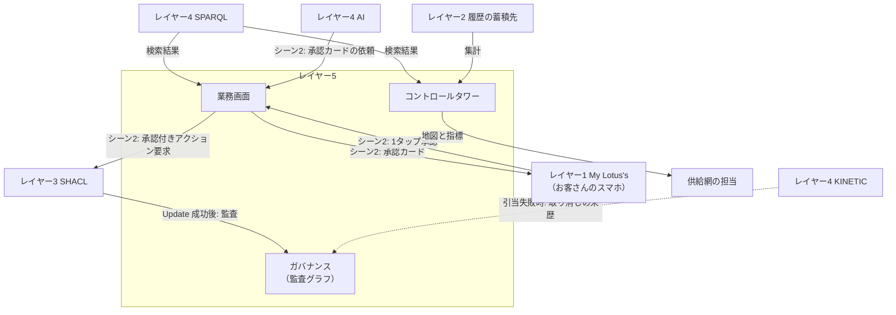

# レイヤー5　業務画面とガバナンス

人と、この構成との接点です。代替案を見て承認し、サプライチェーンの状態を眺め、あとから「誰が承認したか」を説明できる層です。図の Workshop は業務画面、Lineage はデータの来歴に相当する製品の呼び名です。

在庫の本数をここで計算しません。画面はレイヤー4が取ってきたグラフの事実と、レイヤー3の事前検証に合格した提案を表示します。

前後: [レイヤー4 AI推論とキネティック実行](layer-4.md) / [構成図](../system.md) / [ユースケース](../usecase.md)

## 図にあるもの

Metaphactory と React は、画面の作り方の候補です。

| 名前 | ひとことで | この層での役割 |
| --- | --- | --- |
| モデル駆動型Webアプリ | 定義から画面を作るアプリ | オントロジーと SHACL に沿った入力欄や確認画面を出す。シーン2の承認カードもここで作り、My Lotus's に表示させる |
| Metaphactory | その種の製品 | グラフの定義から画面を生成する |
| React | Web画面を組むライブラリ | 業務画面を自作するときの土台 |
| SHACL Form | 点検規則から作る入力フォーム | 支払額や商品の欄が、レイヤー3の規則とずれない |
| GraphQL-LD | 画面向けの読み取り口 | グラフの事実を、Webアプリが取りやすい形で渡す |
| コントロールタワー | 供給網を一目で見る画面 | 店、在庫、配送の状態を地図や指標で見る |
| GeoSPARQL | 場所に関するグラフの問い合わせ | どの店・どの拠点かを位置で絞る |
| BI | 集計とチャート | 履歴の蓄積先から、欠品件数や代替の件数を見る |
| データ来歴 | 事実がどこから来たか | 承認が、いつの、誰の操作から生まれたかを残す |
| 監査 | 後から説明できる記録 | シーン2の「14:22にお客さん自身が承認」を監査グラフに残す |
| 権限 | 誰が何を見られるか | 注文と商品マスタを、見てよい人だけに開く |
| PROV-O | 来歴の標準語彙 | 活動、実行者、時刻、元になったデータを表す |
| ODRL | 利用条件の標準 | 見てよい、更新してよい、の規則を書く |
| Named Graph | 名前の付いた三つ組のまとまり | レイヤー3のストアの中では、注文と商品を分けて権限を掛ける。監査は、この層の監査グラフという別のまとまりに置く |

PROV-O、ODRL、Named Graph は組み合わせです。来歴の書き方、許可の書き方、データを分ける入れ物、という三役です。

## インプット

| どこから | 何が入るか | どの箱が受け取るか |
| --- | --- | --- |
| レイヤー4 SPARQL | 代替候補、商品、店、注文などの検索結果 | 業務画面（UI1）とコントロールタワー（UI2）。GraphQL-LD や GeoSPARQL で受け取る |
| レイヤー2 履歴の蓄積先 | 販売明細と、注文の変更履歴（代替した、代替を取り消した） | コントロールタワーの BI。欠品と代替の件数を数える |
| レイヤー4 AI | 事前検証に合格した提案。「品切れのため、80バーツのまま B社オーガニック牛乳に変えてよいか」 | 業務画面。承認カードにする |
| お客さん（レイヤー1 My Lotus's 経由） | シーン2の1タップ。「変更を承認する」（14:22） | 業務画面。SHACL Form 上の承認になる |
| レイヤー3 SHACL | 再検証に合格し、Update が成功したあとの監査イベント | ガバナンス。PROV-O の来歴として監査グラフに残す |
| レイヤー4 KINETIC | 引当に失敗して注文を元に戻した、という取り消しの来歴 | ガバナンス。承認の来歴と同じ監査グラフに残す |
| 権限の設計者 | 誰が注文を見られ、誰が承認できるか | ガバナンス。ODRL と Named Graph で表す |

## アウトプット

| どこへ | 何が出るか | どの箱から出るか |
| --- | --- | --- |
| レイヤー1 My Lotus's | 承認カード。お客さんのスマホに「お値段そのまま（80バーツ）で B社オーガニック牛乳に変更してよいか」と出る | 業務画面 |
| レイヤー3 SHACL | シーン2の承認付きアクション要求。誰が、いつ承認したかを含む | 業務画面 |
| 供給網を見る人 | 店や配送の地図、欠品や代替の指標 | コントロールタワー |
| この層の中に残る記録 | 「14:22にお客さん自身が承認した」という来歴。引当に失敗したときは、その取り消しの来歴も | ガバナンス（監査グラフ） |

ガバナンスから他の層へ戻る矢印は、構成図にはありません。この箱のアウトプットは、あとから監査できる記録そのものです。注文の中身の更新は、同じ再検証の合格のあと、レイヤー3の RDF に残ります。来歴は監査グラフ、注文明細はトリプルストアと、置き場が分かれています。

## 牛乳が欠品したとき

1. レイヤー3の事前検証に合格した提案が、レイヤー4の AI から業務画面へ届く。コントロールタワーの集計とは別に、業務画面がその提案を承認カードにする。
2. My Lotus's を通じて、スマホに「お値段そのまま（80バーツ）で B社オーガニック牛乳に変更してよいか」と出る。
3. お客さんが14:22に1タップすると、業務画面が承認付きのアクション要求を SHACL へ送る。
4. 再検証に合格し、注文の Update が成功すると、ガバナンスが「14:22、お客さん自身が承認」を PROV-O で監査グラフに残す。あとで引当に失敗して取り消されたときは、その取り消しも同じ監査グラフに残る。
5. 現場の更新、ピッキング、配達の出発が終わると、My Lotus's に配達出発が表示される。この表示はレイヤー1の中の流れで、この層は関わらない。

## 入出力の図

