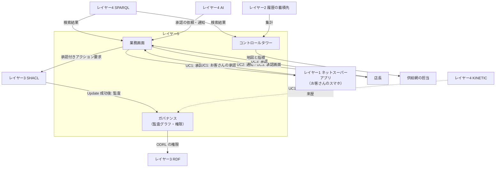

# レイヤー5　業務画面とガバナンス

人と、この構成との接点です。提案を見て承認し、自動で動いた調整の知らせを受け、店と設備と車両の状態を眺め、あとから「誰が、いつ、何を承認したか」「どの規則で自動にしたか」を説明できる層です。図の Workshop は業務画面、Lineage はデータの来歴に相当する製品の呼び名です。

在庫の本数をここで計算しません。画面はレイヤー4が取ってきたグラフの事実と、レイヤー3の事前検証に合格した提案を表示します。

前後: [レイヤー4 AI推論とキネティック実行](layer-4.md) / [構成図](../system.md) / [ユースケース](../usecase.md)

## 図にあるもの

Metaphactory と React は、画面の作り方の候補です。

| 名前 | ひとことで | この層での役割 |
| --- | --- | --- |
| モデル駆動型Webアプリ | 定義から画面を作るアプリ | オントロジーと SHACL に沿った承認画面と通知を作る。お客さん向けの承認カードはネットスーパーアプリに表示させ、店長には店舗タブレットで出す |
| Metaphactory | その種の製品 | グラフの定義から画面を生成する |
| React | Web画面を組むライブラリ | 業務画面を自作するときの土台 |
| SHACL Form | 点検規則から作る入力フォーム | 支払額、設定温度、移動の数量などの欄が、レイヤー3の規則とずれない |
| GraphQL-LD | 画面向けの読み取り口 | グラフの事実を、Webアプリが取りやすい形で渡す |
| コントロールタワー | 供給網を一目で見る画面 | 店、設備、配送車のルートを地図で見て、電力、欠品、店間移動、廃棄を指標で見る |
| GeoSPARQL | 場所に関するグラフの問い合わせ | 店の位置と配送車のルートを地図に重ねる |
| BI | 集計とチャート | 履歴の蓄積先から、電力のピーク、温度の推移、欠品と代替の件数、店間移動と廃棄の量を見る |
| データ来歴 | 事実がどこから来たか | 承認や自動の確定が、いつの、誰の操作や、どの規則から生まれたかを残す |
| 監査 | 後から説明できる記録 | 承認、自動で確定した規則、取り消し、元に戻した操作を監査グラフに残す |
| 権限 | 誰が何を見られ、何を承認できるか | 注文、商品、設備を、見てよい人だけに開く。承認できる人を決める |
| PROV-O | 来歴の標準語彙 | 活動、実行者、時刻、元になったデータを表す |
| ODRL | 利用条件の標準 | 見てよい、更新してよい、承認してよい、の規則を書く |
| Named Graph | 名前の付いた三つ組のまとまり | レイヤー3のストアの中では、商品、店・設備・車両、注文と店間移動、権限を分けて権限を掛ける。監査は、この層の監査グラフという別のまとまりに置く |

PROV-O、ODRL、Named Graph は組み合わせです。来歴の書き方、許可の書き方、データを分ける入れ物、という三役です。

ODRL の規則は、権限の設計者がこの層で書き、レイヤー3のストアの権限の Named Graph に置きます。レイヤー3の SHACL は、承認の点検でその規則を読みます。どのアクションに誰の承認が要るかは [レイヤー3](layer-3.md#承認の要否) の表です。

## 承認する人と画面

| 承認する人 | 画面 | ユースケース |
| --- | --- | --- |
| お客さん | ネットスーパーアプリに出る承認カード | UC1 |
| 店長 | 店舗タブレットの承認画面。自動で確定した調整の通知も、同じ画面に出る | UC2（通知だけ）、UC3（上限を超える店間移動の受け入れ） |

毎日起きることなので、方針の範囲内のアクションは人の承認なしで確定します。人に届くのは、承認が要る例外と、自動で動いたことの通知です。自動で確定したアクションも、どの規則で自動にしたかが監査グラフに残るので、あとから説明できます。

## インプット

| どこから | 何が入るか | どの箱が受け取るか |
| --- | --- | --- |
| レイヤー4 SPARQL | 候補、商品、店、設備、車両、注文、調整計画、店間移動などの検索結果 | 業務画面（UI1）とコントロールタワー（UI2）。GraphQL-LD や GeoSPARQL で受け取る |
| レイヤー2 履歴の蓄積先 | 販売明細、温度と電力の連続記録、在庫移動の履歴、注文の変更履歴 | コントロールタワーの BI |
| レイヤー4 AI | 事前検証に合格した提案と承認の依頼。自動で確定した調整の通知の依頼 | 業務画面 |
| お客さん（レイヤー1 ネットスーパーアプリ経由） | 承認カードへの1タップ。UC1 は「変更を承認する」（14:22） | 業務画面。SHACL Form 上の承認になる |
| 店長 | 承認画面での承認。UC3 は 16:15 | 業務画面 |
| レイヤー3 SHACL | Update が成功したあとの監査イベント。承認が要らないアクションの分も | ガバナンス。PROV-O の来歴として監査グラフに残す |
| レイヤー4 KINETIC | 失敗した変更を元に戻した、という取り消しの来歴（UC1） | ガバナンス。同じ監査グラフに残す |
| 権限の設計者 | 誰が何を見られ、誰が何を承認できるか | ガバナンス。ODRL で書き、レイヤー3の権限の Named Graph に置く |

## アウトプット

| どこへ | 何が出るか | どの箱から出るか |
| --- | --- | --- |
| レイヤー1 ネットスーパーアプリ | お客さんへの承認カード | 業務画面 |
| 店長 | 承認画面と、自動で確定した調整の通知 | 業務画面 |
| レイヤー3 SHACL | 承認付きアクション要求。誰が、いつ承認したかを含む | 業務画面 |
| 供給網を見る人 | 店、設備、配送車のルートの地図と、電力・欠品・店間移動・廃棄の指標 | コントロールタワー |
| レイヤー3 RDF | ODRL の権限 | ガバナンス（権限の設計者） |
| この層の中に残る記録 | 承認、自動で確定した規則、取り消し、元に戻した操作、数量の修正の来歴 | ガバナンス（監査グラフ） |

ガバナンスから他の層へ出るのは、ODRL の権限だけです。監査グラフの記録が他の層へ戻る矢印は、構成図にはありません。監査のアウトプットは、あとから監査できる記録そのものです。中身の更新は、同じ合格のあと、レイヤー3の RDF に残ります。来歴は監査グラフ、事実はトリプルストアと、置き場が分かれています。

## ユースケースごとの動き

### UC1 ネットスーパーの欠品代替

1. レイヤー3の事前検証に合格した提案が、レイヤー4の AI から業務画面へ届く。業務画面がその提案を承認カードにする。
2. ネットスーパーアプリを通じて、スマホに「お値段そのまま（240円）で B社オーガニック牛乳に変更してよいか」と出る。
3. お客さんが14:22に1タップすると、業務画面が承認付きのアクション要求を SHACL へ送る。
4. 再検証に合格し、注文の Update が成功すると、ガバナンスが「14:22、お客さん自身が承認」を PROV-O で監査グラフに残す。あとで引当に失敗して取り消されたときは、その取り消しも同じ監査グラフに残る。
5. 現場の更新、ピッキング、配達の出発が終わると、ネットスーパーアプリに配達出発が表示される。この表示はレイヤー1の中の流れで、この層は関わらない。

### UC2 電力ピークの自動調整

1. 12:35 に調整計画が自動で確定すると、ガバナンスに「方針の範囲内のため承認不要、根拠は設備操作の範囲の規則」と残る。
2. 業務画面が店長のタブレットに「本日の電力調整（自動）」を出す。内容は霜取り12台の時刻変更、冷凍ケースの予冷、14:00〜15:00 の空調26℃、窓際の調光と、見込みのデマンド 762kW。店長は承認しない。止めたいときだけ、画面から取りやめの要求を出せる。
3. 14:20 に AHU-2 を戻したことも、ガバナンスに「売場の快適性の違反（ZT-2 27.2℃）による戻し、承認不要」と残り、タブレットに知らせが出る。
4. コントロールタワーの BI で、今日のデマンドの推移（最大 785kW）と、売場とケースの温度の推移を、履歴の蓄積先の連続記録から見る。毎日の結果を並べると、どの調整がどれだけ効いたかがわかる。

### UC3 夕方の在庫融通と見切り

1. 16:10 に A（牛乳20本の移動）と C（弁当の見切り）が自動で確定すると、ガバナンスに「上限以内のため承認不要」と残る。
2. 業務画面が2号店の店長のタブレットに「3号店からヨーグルト55個を 18:10 に受け入れ、今夜売り切る計画でよいか」と出す。画面には夜の売れ行きの見込み（58個）も出る。
3. 16:15 に店長が承認すると、業務画面が承認付きのアクション要求を SHACL へ送る。合格すると、ガバナンスが「16:15、2号店の店長が受け入れを承認」と残す。
4. 17:05 の数量の修正（20本 → 18本）も、「減らすだけのため承認不要」として残る。
5. コントロールタワーの地図に、V-14 と V-40 の立ち寄りが出る。閉店後、BI で3店の売れ残りと廃棄の量を、店間移動がなかった日と比べる。

## 入出力の図

