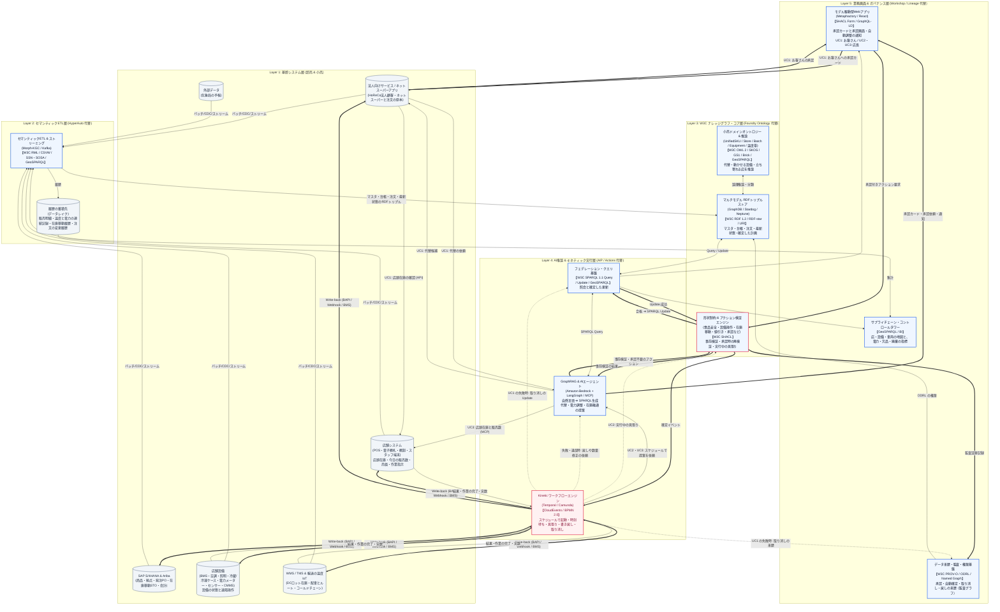

# 小売グループの構成とユースケース

[ユースケース](usecase.md) の3つの場面は、どれもこの構成を同じ型で通る。きっかけを受け、AI がナレッジグラフで調べ、SHACL が事前検証し、必要なときだけ決められた人が承認し、SHACL の再検証と SPARQL Update で確定し、KINETIC が基幹システムと店舗設備へ書き戻す。店頭在庫と今日の販売数はいつも POS が答え、ナレッジグラフは判断と点検と記録を受け持つ。

層ごとの説明: [レイヤー1 基幹システム](docs/layer-1.md)、[レイヤー2 セマンティックETL](docs/layer-2.md)、[レイヤー3 ナレッジグラフ](docs/layer-3.md)、[レイヤー4 AI推論とキネティック実行](docs/layer-4.md)、[レイヤー5 業務画面とガバナンス](docs/layer-5.md)。

## ユースケースごとの経路

- [UC1 ネットスーパーの欠品代替](usecases/uc1-stockout.md): ネットスーパーアプリが POS の店頭在庫を確認し、欠品なら AI に代替を頼む。OWL が同じ容量・同じ区分の牛乳を推論し、AI が欠品代替の方針で提案を作る。SHACL の事前検証、お客さんの1タップ承認、再検証を経て注文を差し替え、KINETIC が POS、SAP、ネットスーパーアプリの順に書き戻す。POS で引当できなければ取り消す
- [UC2 電力ピークの自動調整](usecases/uc2-power-peak.md): 毎日 12:30 に KINETIC のスケジュールが AI に調整案を頼む。OWL が予報、電力メーター、設備台帳から、ピークの見込みと動かせる設備を推論する。SHACL が食品安全、霜取りの間隔、売場の快適性、設備操作の範囲を点検し、方針の範囲内なので承認なしで確定する。KINETIC が BMS で霜取り、予冷、空調、照明を時刻どおりに動かし、実行中は SHACL で温度を見張る。外れたら AI がその設備だけを元に戻す
- [UC3 夕方の在庫融通と見切り](usecases/uc3-evening-transfer.md): 毎日 16:00 に KINETIC のスケジュールが AI に融通の案を頼む。AI が近くの3店の POS に店頭在庫と今日の販売数を聞き、GeoSPARQL で帰り便が立ち寄れる店を探す。上限以内の移動と見切りは承認なしで、上限を超える移動は受け入れる店の店長の承認で確定する。KINETIC が SAP、TMS、スタッフ端末、POS、電子棚札へ書き戻し、数が足りなければ数量を直し、見切りは時刻を待って値引きする
- データの置き場: 商品マスタ、店・設備・車両の台帳、棚割、顧客、注文と、ロット、設備、センサー、電力メーター、予報、売価、車両のルートの最新状態、確定した調整計画・店間移動・見切りはトリプルストアに入る。販売明細、温度と電力の連続記録、在庫移動や発注の履歴、注文の変更履歴は履歴の蓄積先に入る。承認、自動で確定した規則、取り消し、元に戻した操作の来歴はレイヤー5の監査グラフに入る

## 構成図

承認が要らないアクション（UC2 の方針の範囲内の調整と元に戻す操作、UC3 の上限以内の移動・見切り・数量の減少など）は、事前検証のあとに承認と再検証を飛ばして、そのまま Update と確定イベントへ進む。どのアクションに誰の承認が要るかは [レイヤー3](docs/layer-3.md#承認の要否) で決めている。
