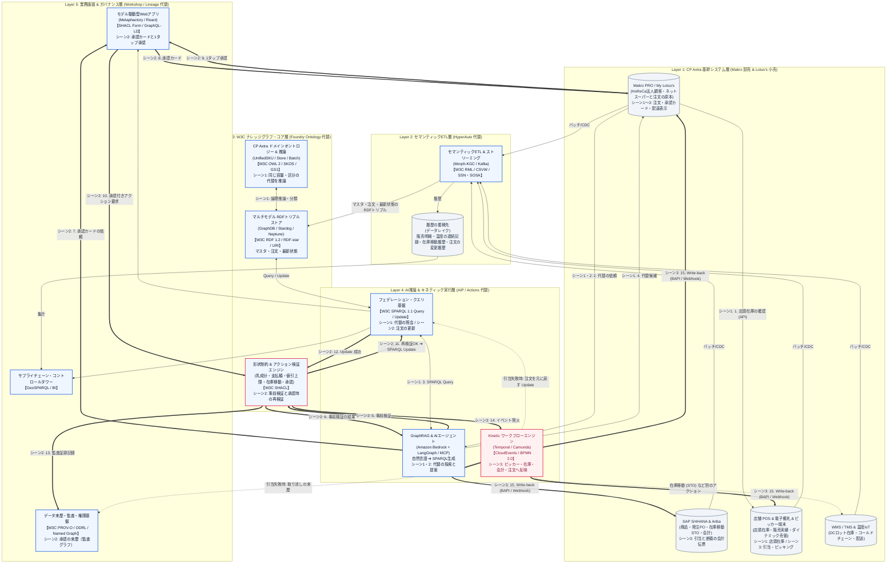

# CP Axtra 構成と欠品代替

[usecase.md](usecase.md) の欠品代替は、次の経路でこの構成を通る。店頭在庫の確認と引当はネットスーパー（My Lotus's）が POS に対して行い、ナレッジグラフは代替の判断と点検を受け持つ。

層ごとの説明: [レイヤー1 基幹システム](docs/layer-1.md)、[レイヤー2 セマンティックETL](docs/layer-2.md)、[レイヤー3 ナレッジグラフ](docs/layer-3.md)、[レイヤー4 AI推論とキネティック実行](docs/layer-4.md)、[レイヤー5 業務画面とガバナンス](docs/layer-5.md)。

- シーン1: My Lotus's が POS の店頭在庫を確認する。欠品なら AI（Bedrock 上の LangGraph エージェント）に代替を頼み、AI が SPARQL で問い合わせ、OWL が同じ容量・同じ区分の牛乳を推論する。候補の在庫も My Lotus's が POS で確認する
- シーン2: AI がレイヤー3の欠品代替の方針（支払額は元のまま、差額は店舗負担）で提案を作り、SHACL が事前検証する（乳成分の一致、支払額上限、値引上限）。合格したら業務画面が承認カードを出す。1タップ承認は承認付きのアクション要求になり、SHACL が承認の有無を加えて再検証する。合格すると SPARQL Update で注文の対象商品を差し替え、Update の成功を受けて PROV-O の来歴が監査グラフに残る
- シーン3: KINETIC が POS（ピッカー端末と引当）、SAP（引当と会計伝票）、My Lotus's（注文の原本）の順に書き戻す。POS で引当できなければ、残りを止めて注文を元に戻し、取り消しの来歴を残してお客さんに伝える。ピッキング完了と配達出発は、レイヤー1の中で My Lotus's に表示される
- データの置き場: 商品マスタ、顧客、注文と、ロットの最新状態、センサーごとの最新の温度、今の売価はトリプルストアに入る。販売明細、温度の連続記録、在庫移動や発注の履歴、注文の変更履歴は履歴の蓄積先に入る。承認と取り消しの来歴はレイヤー5の監査グラフに入る

