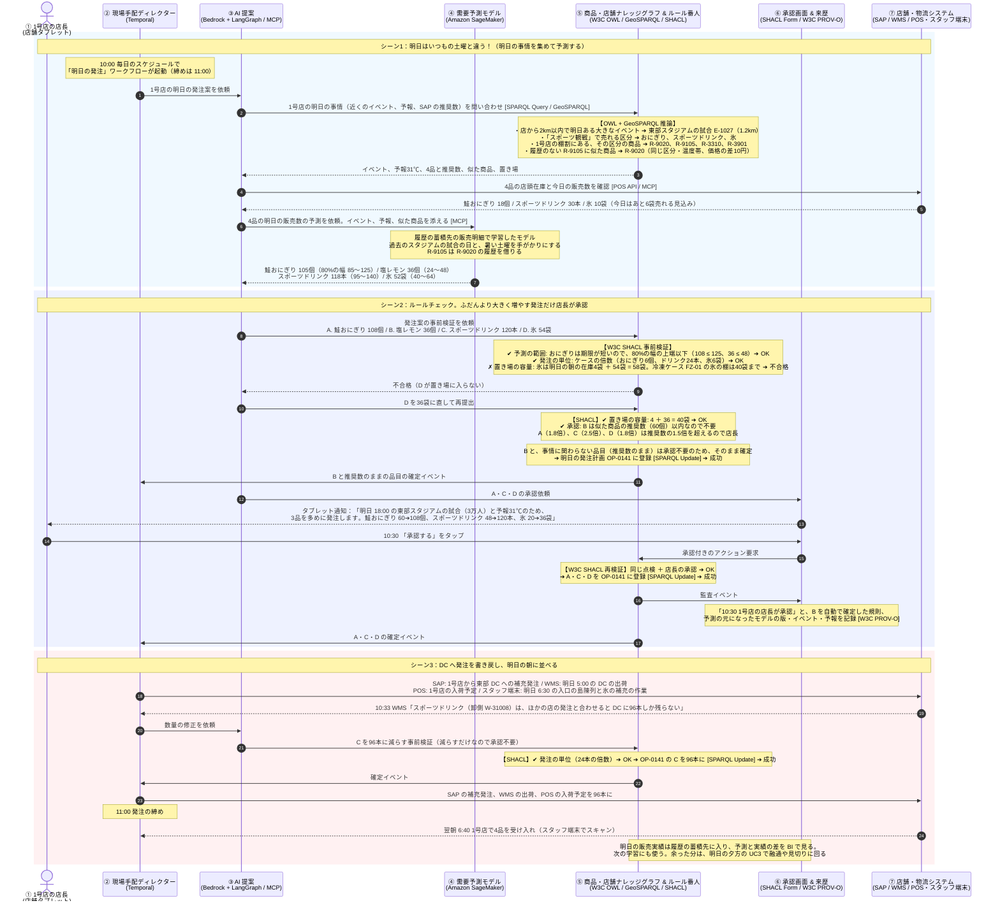

# UC1　明日の発注と需要予測

毎朝、店が配送センター（DC）へ出す「明日の分」の発注を、需要予測で決める流れです。ふだんの日は、SAP の自動補充が過去の同じ曜日の販売から出す推奨数のままで足ります。ところが、近くで大きなイベントがある日、暑い日、新商品の発売日は、推奨数のままだと品切れします。この流れでは、ナレッジグラフがそうした明日の事情を集めます。需要予測モデルが数を出し、SHACL が置き場と期限の点検をし、ふだんより大きく増やすときだけ店長が承認します。

前後: [ユースケース一覧](../usecase.md) / [UC2 電力ピークの自動調整](uc2-power-peak.md)

## 前提

| 項目 | 値 |
| --- | --- |
| 舞台 | 1号店（ST-014）と、そこへ毎朝届ける東部 DC（DC-01） |
| きっかけ | 毎日 10:00 の KINETIC のスケジュール。DC への発注の締めは 11:00、届くのは明日の朝 6:30 |
| 明日の事情 | 1号店から1.2kmの東部スタジアムで、18:00 からサッカーの試合（E-1027、来場見込み3万人）。予報の最高気温は31℃。C社の新商品「塩レモンおにぎり」の発売日 |
| 見る商品 | 鮭おにぎり（R-9020）、塩レモンおにぎり（R-9105、販売の履歴なし）、スポーツドリンク 500ml（R-3310）、氷 1kg（R-3901） |
| SAP の推奨数 | 鮭おにぎり60個、スポーツドリンク48本、氷20袋。塩レモンおにぎりは履歴がないので推奨数なし |
| 承認する人 | 推奨数の1.5倍以内の発注と、似た商品の推奨数以内の新商品の発注は不要。それを超える発注は1号店の店長 |
| 使う点検 | 予測の範囲、発注の単位、置き場の容量、承認 |
| 書き戻し先 | SAP（DC への補充発注）、WMS（DC の明日の出荷）、店舗システム（スタッフ端末、POS） |

ほかの日配品と惣菜（約200品目）も同じワークフローで見ます。明日の事情に関わらない商品は、推奨数のまま自動で確定します。ここでは事情に関わる4品だけを追います。

## 流れ

## 予測と発注

| 商品 | SAP の推奨数 | 予測（80%の幅） | 最初の案 | 確定した発注 | 承認 |
| --- | --- | --- | --- | --- | --- |
| 鮭おにぎり R-9020 | 60個 | 105個（85〜125） | 108個 | 108個 | 店長（1.8倍） |
| 塩レモンおにぎり R-9105 | なし | 36個（24〜48） | 36個 | 36個 | 不要（似た商品 R-9020 の推奨数以内） |
| スポーツドリンク R-3310 | 48本 | 118本（95〜140） | 120本 | 96本（DC の在庫に合わせて修正） | 店長（2.5倍）。修正は減らすだけなので不要 |
| 氷 R-3901 | 20袋 | 52袋（40〜64） | 54袋 | 36袋（置き場の容量に合わせて修正） | 店長（1.8倍） |

おにぎりは期限が短いので、予測の幅の上端より多くは頼みません。上振れに賭けて余ると廃棄になるからです。スポーツドリンクと氷は期限が長いので、余っても翌日以降に売れます。この商品の違いは、レイヤー3の点検の規則に書いてあります。

予測の数を出すのは需要予測モデルで、ナレッジグラフではありません。ナレッジグラフは「明日は何がある日か」「どの商品がそれに関わるか」「履歴のない商品はどれに似ているか」「どこに置けるか」を答えます。その答えを特徴として渡すと、モデルの予測が明日の事情を反映します。

## 層ごとの詳しい動き

| 層 | 見るところ |
| --- | --- |
| レイヤー1 | [UC1 の動き](../docs/layer-1.md#uc1-明日の発注と需要予測) |
| レイヤー2 | [UC1 の動き](../docs/layer-2.md#uc1-明日の発注と需要予測) |
| レイヤー3 | [UC1 の動き](../docs/layer-3.md#uc1-明日の発注と需要予測) |
| レイヤー4 | [UC1 の動き](../docs/layer-4.md#uc1-明日の発注と需要予測) |
| レイヤー5 | [UC1 の動き](../docs/layer-5.md#uc1-明日の発注と需要予測) |
