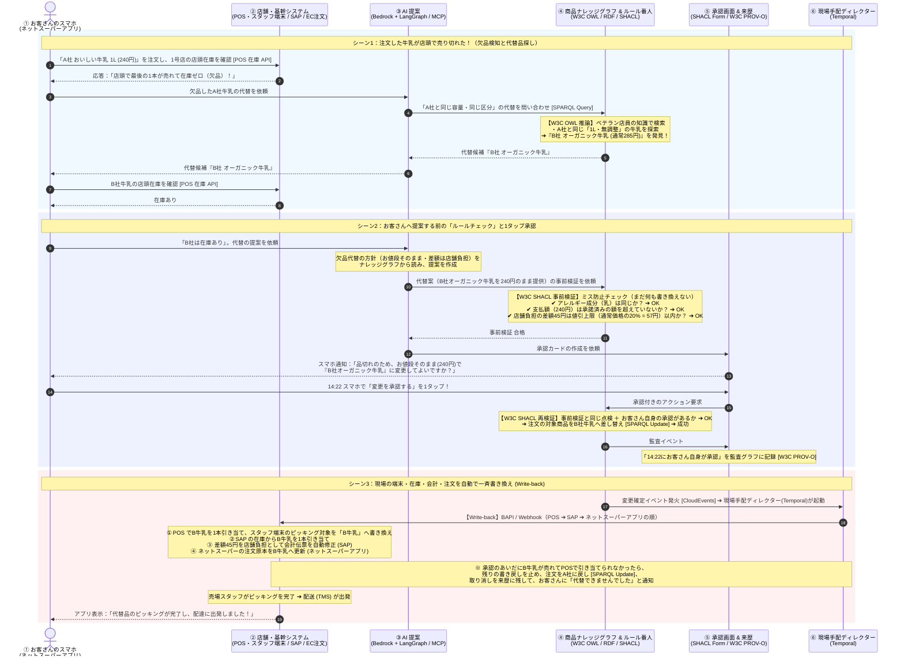

# UC1　ネットスーパーの欠品代替

ネットスーパーで注文した牛乳が店頭で売り切れたとき、代替品を探し、お客さんの承認を得て、現場のシステムへ書き戻すまでの流れです。

前後: [ユースケース一覧](../usecase.md) / [UC2 電力ピークの自動調整](uc2-power-peak.md)

## 前提

| 項目 | 値 |
| --- | --- |
| 出荷店 | 1号店（ST-014） |
| 注文 | 8841。A社 おいしい牛乳 1L（R-5502）を240円。配達枠 15:00〜16:00 |
| 代替候補 | B社 オーガニック牛乳 1L（R-5581）。通常285円 |
| 承認する人 | お客さん |
| 使う点検 | 乳成分の一致、支払額上限、値引上限、承認 |
| 書き戻し先 | 店舗システム（POS とスタッフ端末）、SAP、ネットスーパーアプリ |

## 流れ

## 層ごとの詳しい動き

| 層 | 見るところ |
| --- | --- |
| レイヤー1 | [UC1 の動き](../docs/layer-1.md#uc1-ネットスーパーの欠品代替) |
| レイヤー2 | [UC1 の動き](../docs/layer-2.md#uc1-ネットスーパーの欠品代替) |
| レイヤー3 | [UC1 の動き](../docs/layer-3.md#uc1-ネットスーパーの欠品代替) |
| レイヤー4 | [UC1 の動き](../docs/layer-4.md#uc1-ネットスーパーの欠品代替) |
| レイヤー5 | [UC1 の動き](../docs/layer-5.md#uc1-ネットスーパーの欠品代替) |
