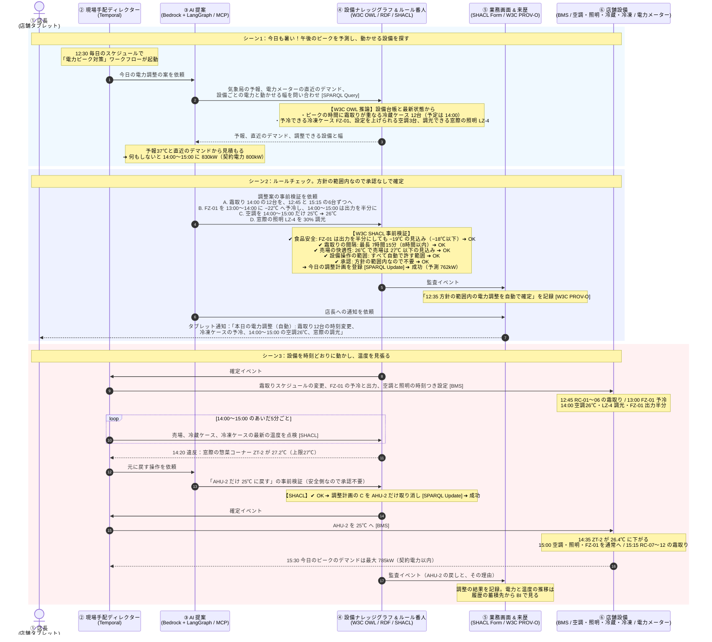

# UC2　電力ピークの自動調整

暑い午後に店の電力が契約電力を超えそうなとき、食品の温度と売場の快適さを守れる範囲で設備を動かし、ピークを削る流れです。冷蔵ケースの霜取りの時刻をずらし、冷凍ケースを先に冷やしておき、空調と照明を少し弱めます。実行中は温度を見張り、外れたらすぐ元に戻します。暑い季節は暑い日がほぼ毎日続くので、この調整も毎日動きます。

前後: [UC1 ネットスーパーの欠品代替](uc1-stockout.md) / [ユースケース一覧](../usecase.md) / [UC3 夕方の在庫融通と見切り](uc3-evening-transfer.md)

## 前提

| 項目 | 値 |
| --- | --- |
| 舞台 | 1号店（ST-014） |
| きっかけ | 毎日 12:30 の KINETIC のスケジュール |
| 契約電力 | 800kW。15分ごとのデマンド（平均電力）がこれを超えると、電気の基本料金が上がる |
| 今日の予測 | 外気温の予報は37℃。何もしないと 14:00〜15:00 のデマンドが 830kW になる |
| 調整する設備 | 冷蔵ケース RC-01〜12（霜取りの時刻）、冷凍ケース FZ-01（予冷と出力）、空調 AHU-1〜3（設定温度）、照明 LZ-4（窓際の調光） |
| 守ること | 冷蔵ケースは冷蔵（0〜5℃）、冷凍ケースは冷凍（−18℃以下）のまま。霜取りの間隔は8時間以内。売場の温度は27℃以下 |
| 承認する人 | 方針の範囲内の調整は不要。店長には通知だけが届く |
| 使う点検 | 食品安全、霜取りの間隔、売場の快適性、設備操作の範囲、承認 |
| 書き戻し先 | BMS |

霜取りは、冷蔵ケースの冷却器に付いた霜をヒーターで溶かす運転です。そのあいだ電力が増えるので、ピークの時間から外すと効きます。

## 流れ

## 方針の範囲

人の承認なしで動かしてよい範囲は、次のとおりです（値は説明用）。正式な定義は [レイヤー3 の SHACL の定義](../docs/layer-3.md#shacl-の定義) にあり、この表はその写しです。この外の調整を AI が出すと、店長の承認が要ります。たとえば空調を27℃にする案や、生鮮売場の照明を暗くする案です。

| 設備 | 自動で動かしてよい範囲 |
| --- | --- |
| 冷蔵ケースの霜取り | 時刻を前後に動かしてよい。間隔は8時間以内 |
| 冷凍ケース | 設定温度は −24〜−18℃。出力は半分まで |
| 空調 | 設定温度は 24〜26℃ |
| 照明 | 窓際のゾーンだけ、30%まで調光 |
| 元に戻す操作 | いつでもよい（安全側） |

## 層ごとの詳しい動き

| 層 | 見るところ |
| --- | --- |
| レイヤー1 | [UC2 の動き](../docs/layer-1.md#uc2-電力ピークの自動調整) |
| レイヤー2 | [UC2 の動き](../docs/layer-2.md#uc2-電力ピークの自動調整) |
| レイヤー3 | [UC2 の動き](../docs/layer-3.md#uc2-電力ピークの自動調整) |
| レイヤー4 | [UC2 の動き](../docs/layer-4.md#uc2-電力ピークの自動調整) |
| レイヤー5 | [UC2 の動き](../docs/layer-5.md#uc2-電力ピークの自動調整) |
