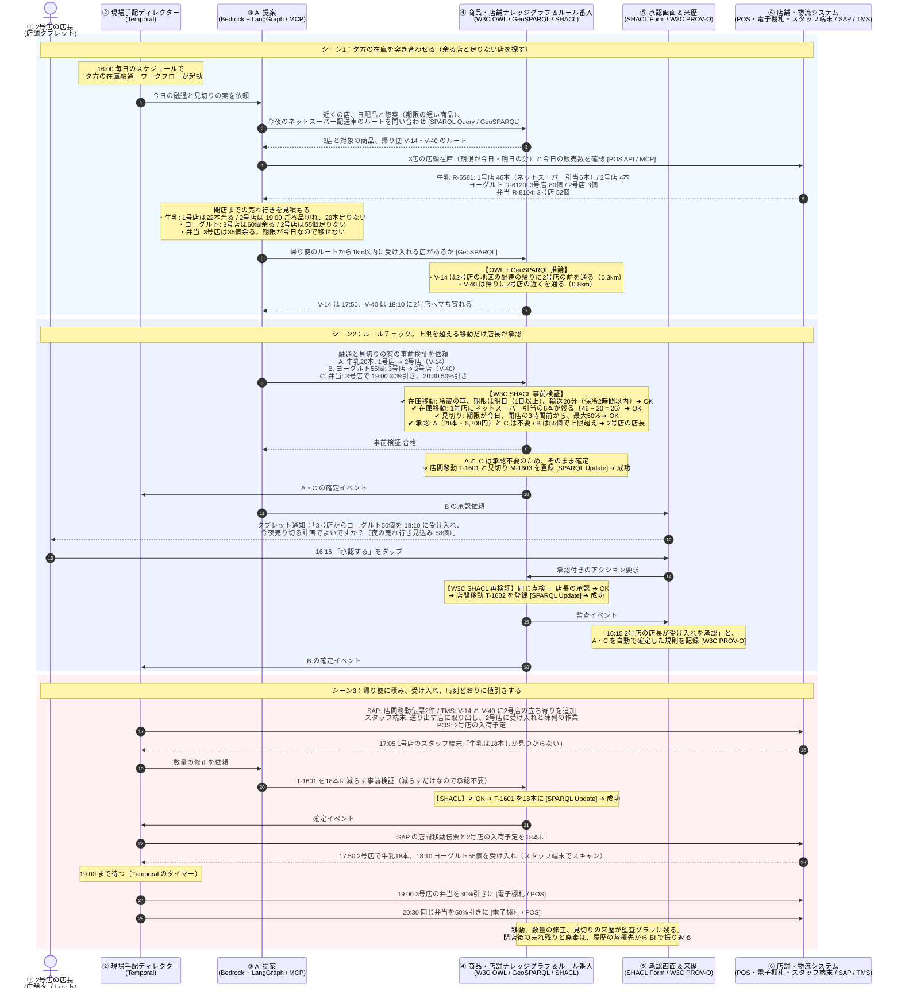

# UC3　夕方の在庫融通と見切り

毎日の夕方、近くの店どうしで「閉店までに余りそうな商品」と「夜に品切れしそうな商品」を突き合わせ、ネットスーパー配送車の帰り便で余る店から足りない店へ移す流れです。期限が今日までで移せない商品は、電子棚札で時刻を決めて見切り値引きします。朝の UC1 で、イベントや暑さに備えて多めに発注した分が余りそうなときも、ここで回します。

前後: [UC2 電力ピークの自動調整](uc2-power-peak.md) / [ユースケース一覧](../usecase.md)

## 前提

| 項目 | 値 |
| --- | --- |
| 舞台 | 近くの3店。1号店（ST-014）、2号店（ST-031）、3号店（ST-040）。閉店は 22:00 |
| きっかけ | 毎日 16:00 の KINETIC のスケジュール |
| 見る商品 | 期限が今日か明日の日配品と惣菜 |
| 移すもの | B社 オーガニック牛乳（R-5581、期限は明日）20本を、1号店から2号店へ ヨーグルト（R-6120、期限は明日）55個を、3号店から2号店へ |
| 見切るもの | 3号店の弁当（R-8104、期限は今日）。19:00 から30%引き、20:30 から50%引き |
| 運ぶ車 | ネットスーパー配送車の帰り便。V-14（1号店の冷蔵車、2号店の地区の配達の帰り）、V-40（3号店の冷蔵車） |
| 承認する人 | 上限（50個かつ15,000円）以内の移動と、上限以内の見切りは不要。ヨーグルト55個は上限を超えるので、受け入れる2号店の店長 |
| 使う点検 | 在庫移動ルール（温度帯、期限、保冷時間、車の空き、ネットスーパーの引当分）、見切りの値引上限、承認 |
| 書き戻し先 | SAP（店間移動）、TMS（帰り便の立ち寄り）、店舗システム（スタッフ端末、POS、電子棚札） |

## 流れ

## 層ごとの詳しい動き

| 層 | 見るところ |
| --- | --- |
| レイヤー1 | [UC3 の動き](../docs/layer-1.md#uc3-夕方の在庫融通と見切り) |
| レイヤー2 | [UC3 の動き](../docs/layer-2.md#uc3-夕方の在庫融通と見切り) |
| レイヤー3 | [UC3 の動き](../docs/layer-3.md#uc3-夕方の在庫融通と見切り) |
| レイヤー4 | [UC3 の動き](../docs/layer-4.md#uc3-夕方の在庫融通と見切り) |
| レイヤー5 | [UC3 の動き](../docs/layer-5.md#uc3-夕方の在庫融通と見切り) |
